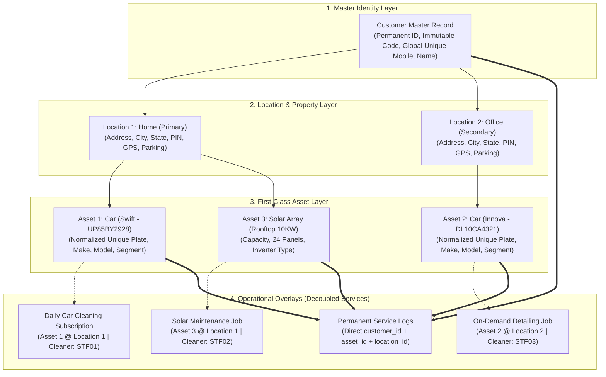
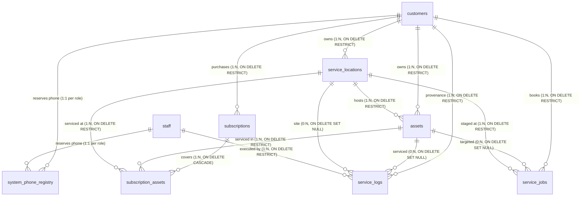
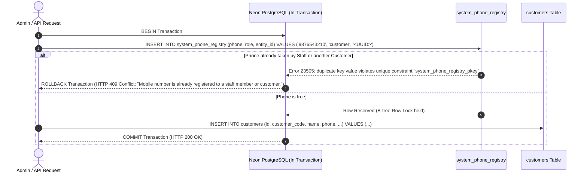
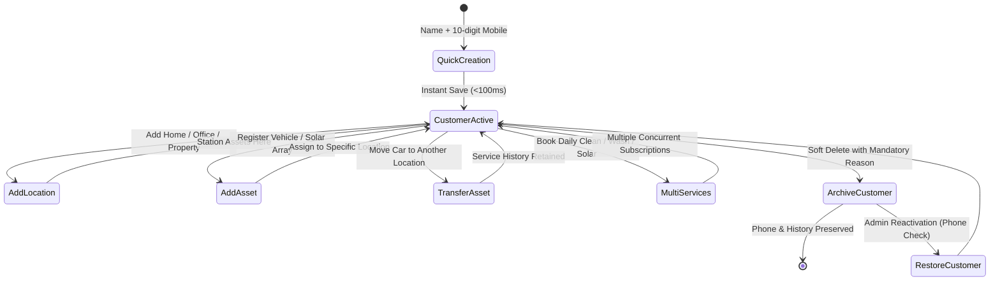
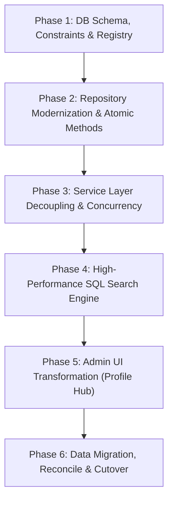

# CWP DATA APP — CUSTOMER MASTER TARGET ARCHITECTURE BLUEPRINT
**Document Reference:** `docs/architecture/CUSTOMER_MASTER_TARGET_ARCHITECTURE.md`  
**Project:** CWP Customer Data App (CWP Detailers & Motors)  
**Task Reference:** AGENT TASK 01.1 (Customer Master Target Architecture Specification)  
**Target Environment:** Neon PostgreSQL (`cwp_customer_db`), Node.js Application Layer, Admin SPA  
**Status:** PROPOSED & APPROVED DESIGN SPECIFICATION (Read-Only Specification — Zero Code / DDL Executed)  
**Date:** November 2026  
**Auditor & Lead Architect:** Antigravity AI Engineering Architecture Team

---

## Table of Contents
1. [Executive Architectural Summary](#1-executive-architectural-summary)
2. [Target Domain Entities & Relational Data Model](#2-target-domain-entities--relational-data-model)
3. [Global Customer Identity & Contact Uniqueness Architecture](#3-global-customer-identity--contact-uniqueness-architecture)
4. [Asset & Vehicle Architecture](#4-asset--vehicle-architecture)
5. [End-to-End Customer Lifecycle Workflows](#5-end-to-end-customer-lifecycle-workflows)
6. [Admin Customer Profile Hub UI/UX Specification](#6-admin-customer-profile-hub-uiux-specification)
7. [High-Performance Search & Scalability Architecture](#7-high-performance-search--scalability-architecture)
8. [Data Integrity, Constraints & Transactional Guarantees](#8-data-integrity-constraints--transactional-guarantees)
9. [Phased Migration & Implementation Strategy](#9-phased-migration--implementation-strategy)
10. [Testable Acceptance Criteria & Verification Matrix](#10-testable-acceptance-criteria--verification-matrix)

---

## 1. Executive Architectural Summary

### 1.1 Purpose & Scope
This blueprint establishes the authoritative target architecture for the **Customer Master** subsystem of the CWP Customer Data App. It directly resolves the critical architectural defects, data integrity hazards, and usability bottlenecks identified in the Task 01 Architecture Audit.

This document establishes the single source of truth for:
- Decoupling customer identity permanently from packages, routes, cleaner assignments, and service categories.
- Enforcing global, role-isolated, and concurrency-proof Indian mobile number uniqueness.
- Establishing the strict relational hierarchy:
  $$\mathbf{Customer} \longrightarrow \mathbf{Multiple\ Locations} \longrightarrow \mathbf{Multiple\ Assets / Vehicles}$$
- Treating every asset (cars, bikes, rooftop solar installations) as an individually addressable first-class entity rather than a flattened text string.
- Enabling multi-service concurrency (a customer maintaining daily car cleaning, on-demand detailing, and rooftop solar cleaning simultaneously without mutual interference).
- Delivering a unified Admin Customer Profile Hub and high-velocity 10-second customer creation.
- Providing database-level SQL search that scales efficiently past 50,000+ records.



---

## 2. Target Domain Entities & Relational Data Model

### 2.1 Entity Relationship Diagram (Target Schema)



---

### 2.2 Target Entity Specifications

#### Entity 1: Customer Master (`public.customers`)
**Purpose:** Permanent, immutable identity of the customer. Completely independent of services, jobs, or cleaner assignments. A customer may exist indefinitely with zero locations, zero assets, zero subscriptions, and zero booked jobs.

```sql
CREATE TABLE public.customers (
    id UUID PRIMARY KEY DEFAULT gen_random_uuid(),
    customer_code VARCHAR(20) NOT NULL UNIQUE,          -- Permanent invariant format: e.g. CUST-10482
    name VARCHAR(150) NOT NULL,                         -- Full customer name
    name_hi VARCHAR(150) NULL,                          -- Devanagari Hindi transliterated name
    phone VARCHAR(10) NOT NULL,                         -- Normalized 10-digit Indian mobile [6-9]\d{9}
    alt_phone VARCHAR(15) NULL,                         -- Optional secondary phone
    email VARCHAR(150) NULL,                            -- Optional email address
    customer_status VARCHAR(20) NOT NULL DEFAULT 'active' 
        CHECK (customer_status IN ('active', 'inactive', 'archived')),
    notes TEXT NULL,                                    -- Master profile notes
    tags JSONB NOT NULL DEFAULT '[]'::jsonb,            -- e.g. ["vip", "commercial", "referral"]
    created_at TIMESTAMPTZ NOT NULL DEFAULT CURRENT_TIMESTAMP,
    updated_at TIMESTAMPTZ NOT NULL DEFAULT CURRENT_TIMESTAMP,
    deleted_at TIMESTAMPTZ NULL,                        -- Soft deletion / archival timestamp
    deleted_by VARCHAR(100) NULL,
    deletion_reason TEXT NULL
);

-- Partial Unique Index on Customer Mobile (Only active, non-archived records)
CREATE UNIQUE INDEX uq_customers_phone_active 
ON public.customers (phone) 
WHERE deleted_at IS NULL;

-- Invariant Customer Code Search Index
CREATE UNIQUE INDEX uq_customers_code_upper 
ON public.customers (UPPER(customer_code));
```

#### Entity 2: Customer Location (`public.service_locations`)
**Purpose:** Represents an identifiable physical property, premises, or service address owned or occupied by the customer. Allows a customer to station different vehicles and receive services at distinct geographic locations.

```sql
CREATE TABLE public.service_locations (
    id UUID PRIMARY KEY DEFAULT gen_random_uuid(),
    customer_id UUID NOT NULL REFERENCES public.customers(id) ON DELETE RESTRICT,
    location_label VARCHAR(60) NOT NULL,               -- e.g. 'Home', 'Office', 'Factory', 'Farmhouse'
    address_line1 TEXT NOT NULL,                       -- House/Plot/Street/Society details
    address_line2 TEXT NULL,                           -- Sub-locality, sector, floor
    landmark VARCHAR(255) NULL,                        -- Nearby landmark
    city VARCHAR(100) NOT NULL DEFAULT 'Lucknow',
    state VARCHAR(100) NOT NULL DEFAULT 'Uttar Pradesh',
    pin_code VARCHAR(10) NOT NULL DEFAULT '226010',
    address_hi TEXT NULL,                              -- Devanagari Hindi address
    google_maps_url TEXT NULL,                         -- Direct Maps URL or Plus Code
    latitude NUMERIC(10, 7) NULL,                      -- Verified GPS Latitude
    longitude NUMERIC(10, 7) NULL,                     -- Verified GPS Longitude
    parking_details VARCHAR(255) NULL,                 -- Parking bay, basement level, gate guard instructions
    location_notes TEXT NULL,                          -- Gate access, water source instructions
    photo_url TEXT NULL,                               -- Site entrance / building photo
    is_primary BOOLEAN NOT NULL DEFAULT FALSE,         -- Master dispatch location
    status VARCHAR(20) NOT NULL DEFAULT 'active' 
        CHECK (status IN ('active', 'inactive', 'archived')),
    created_at TIMESTAMPTZ NOT NULL DEFAULT CURRENT_TIMESTAMP,
    updated_at TIMESTAMPTZ NOT NULL DEFAULT CURRENT_TIMESTAMP,
    deleted_at TIMESTAMPTZ NULL,
    
    -- Compound Unique Key ensuring location belongs to customer for compound FKs
    CONSTRAINT uq_locations_id_customer UNIQUE (id, customer_id)
);

-- Compound Index for Customer Multi-Location Querying
CREATE INDEX idx_locations_customer_status 
ON public.service_locations (customer_id, status) 
WHERE deleted_at IS NULL;

-- Exact-one Primary Location constraint per customer
CREATE UNIQUE INDEX uq_one_primary_location_per_customer 
ON public.service_locations (customer_id) 
WHERE is_primary = TRUE AND deleted_at IS NULL;
```

#### Entity 3: Customer Asset (`public.assets`)
**Purpose:** Replaces the legacy, flattened single-vehicle model. Represents any distinct physical asset owned by the customer, stationed at a specific location, and receiving services (Vehicles, Motorcycles, Rooftop Solar Arrays).

```sql
CREATE TABLE public.assets (
    id UUID PRIMARY KEY DEFAULT gen_random_uuid(),
    customer_id UUID NOT NULL REFERENCES public.customers(id) ON DELETE RESTRICT,
    location_id UUID NOT NULL,                         -- Current location where asset is stationed
    asset_type VARCHAR(30) NOT NULL DEFAULT 'car' 
        CHECK (asset_type IN ('car', 'motorcycle', 'solar_array', 'commercial_ev', 'other')),
    
    -- Vehicle Specific Attributes (asset_type IN ('car', 'motorcycle'))
    registration_no VARCHAR(20) NULL,                  -- Normalized uppercase alphanumeric plate e.g. 'UP85BY2928'
    has_unknown_registration BOOLEAN NOT NULL DEFAULT FALSE, -- Flag for unregistered / new vehicles awaiting HSRP
    temporary_identifier VARCHAR(60) NULL,             -- e.g. 'NEW-HYUNDAI-CRETA-DELIVERY-NOV26'
    make VARCHAR(100) NULL,                            -- e.g. 'Maruti Suzuki', 'Hyundai', 'Tata Motors'
    model VARCHAR(100) NULL,                           -- e.g. 'Swift ZXI', 'Creta SX', 'Nexon EV'
    color VARCHAR(50) NULL,                            -- e.g. 'Polar White', 'Phantom Black'
    segment VARCHAR(30) NULL DEFAULT 'hatchback'       -- 'hatchback', 'sedan', 'compact_suv', 'full_suv', 'luxury'
        CHECK (segment IS NULL OR segment IN ('hatchback', 'sedan', 'compact_suv', 'full_suv', 'luxury', 'bike')),
    
    -- Solar Array Specific Attributes (asset_type = 'solar_array')
    solar_site_name VARCHAR(100) NULL,                 -- e.g. 'Rooftop 10KW Solar Plant - A Block'
    panel_count INTEGER NULL CHECK (panel_count IS NULL OR panel_count > 0),
    inverter_capacity_kw NUMERIC(6, 2) NULL,           -- e.g. 5.00, 10.00 KW
    roof_type VARCHAR(50) NULL,                        -- 'RCC Flat', 'Tin Shed', 'Sloped Tile'
    water_source_details TEXT NULL,                    -- Water valve location, pipe connection
    
    photo_url TEXT NULL,                               -- Asset CDN photo
    status VARCHAR(20) NOT NULL DEFAULT 'active' 
        CHECK (status IN ('active', 'inactive', 'archived', 'sold')),
    created_at TIMESTAMPTZ NOT NULL DEFAULT CURRENT_TIMESTAMP,
    updated_at TIMESTAMPTZ NOT NULL DEFAULT CURRENT_TIMESTAMP,
    deleted_at TIMESTAMPTZ NULL,

    -- Compound Foreign Key guaranteeing asset is stationed at a location owned by the same customer
    CONSTRAINT fk_asset_customer_location 
        FOREIGN KEY (location_id, customer_id) 
        REFERENCES public.service_locations(id, customer_id) 
        ON DELETE RESTRICT,
        
    -- Compound Unique Key enabling downstream compound foreign keys
    CONSTRAINT uq_assets_id_customer UNIQUE (id, customer_id),
    
    -- Invariant: Vehicles must have either a valid registration plate OR has_unknown_registration = TRUE
    CONSTRAINT chk_vehicle_registration_validity CHECK (
        (asset_type NOT IN ('car', 'motorcycle')) OR
        (registration_no IS NOT NULL AND TRIM(registration_no) != '') OR
        (has_unknown_registration = TRUE)
    ),
    
    -- Invariant: Solar arrays must define panel_count
    CONSTRAINT chk_solar_panel_count CHECK (
        (asset_type != 'solar_array') OR
        (panel_count IS NOT NULL AND panel_count > 0)
    )
);

-- Global Unique License Plate Index (Normalized Alphanumeric, Active Only)
-- In PostgreSQL, multiple NULLs do NOT violate unique constraint! Unregistered vehicles have registration_no = NULL.
CREATE UNIQUE INDEX uq_assets_registration_no_active 
ON public.assets (UPPER(REGEXP_REPLACE(registration_no, '[^A-Za-z0-9]', '', 'g'))) 
WHERE registration_no IS NOT NULL AND deleted_at IS NULL;

-- Assets by Location Index
CREATE INDEX idx_assets_location 
ON public.assets (location_id, status) 
WHERE deleted_at IS NULL;
```

#### Entity 4: Unified Contact Registry (`public.system_phone_registry`)
**Purpose:** Technical engine ensuring strict, role-isolated, concurrency-proof uniqueness across all customer and staff telephone numbers. (Detailed in Section 3).

#### Entity 5: Direct Service Provenance on `public.service_logs`
**Purpose:** Guarantees that every completed, skipped, or cancelled operational log permanently retains direct linkage to the Master Customer, Asset, and Location.

```sql
-- Alteration specification to existing service_logs
ALTER TABLE public.service_logs 
    ADD COLUMN IF NOT EXISTS customer_id UUID NULL 
        REFERENCES public.customers(id) ON DELETE RESTRICT,
    ADD COLUMN IF NOT EXISTS asset_id UUID NULL 
        REFERENCES public.assets(id) ON DELETE SET NULL,
    ADD COLUMN IF NOT EXISTS location_id UUID NULL 
        REFERENCES public.service_locations(id) ON DELETE SET NULL;

-- Backfill provenance from active subscriptions and jobs
UPDATE public.service_logs sl
SET customer_id = sub.customer_id
FROM public.subscriptions sub
WHERE sl.subscription_id = sub.id AND sl.customer_id IS NULL;

UPDATE public.service_logs sl
SET customer_id = sj.customer_id
FROM public.service_jobs sj
WHERE sl.job_id = sj.id AND sl.customer_id IS NULL;

-- Set NOT NULL constraint once historical backfill completes
-- ALTER TABLE public.service_logs ALTER COLUMN customer_id SET NOT NULL;

CREATE INDEX IF NOT EXISTS idx_service_logs_customer 
ON public.service_logs (customer_id, service_date DESC);
```

---

## 3. Global Customer Identity & Contact Uniqueness Architecture

### 3.1 Problem Statement
The current system allows duplicate customer phone numbers because `customers.phone` only possesses a non-unique B-tree index, and `adminService.saveCustomer` performs a blind insert. Furthermore, `staff.phone` and `customers.phone` exist in separate tables with zero cross-role collision checks.

### 3.2 Evaluation of Uniqueness Architectures

| Approach | Architecture Description | Concurrency Handling | Cross-Role Isolation | Implementation Complexity | Recommendation |
|---|---|:---:|:---:|:---:|:---:|
| **Approach 1: Application-Level Pre-Flight Checks** | `repos.customers.findByPhone()` and `repos.staff.findByPhone()` before insert in service code. | **FAIL** (Vulnerable to concurrent race conditions) | **PARTIAL** (Fragile, depends on developer discipline) | Low | **REJECTED** |
| **Approach 2: Dual Cross-Table Database Triggers** | `BEFORE INSERT OR UPDATE` trigger on `customers` queries `staff`; trigger on `staff` queries `customers`. | **PARTIAL** (Requires explicit row-locking or `SERIALIZABLE` isolation) | **PASS** | Medium | **VIABLE ALTERNATIVE** |
| **Approach 3: Unified Phone Registry Table (`system_phone_registry`)** | Dedicated atomic table storing `phone PRIMARY KEY`, `role`, and `entity_id`. All phone allocations insert into registry within the entity transaction. | **PASS** (PostgreSQL B-tree engine-level lock prevents race conditions) | **PASS** (Enforced by single declarative Primary Key) | Low-Medium | **RECOMMENDED** |

### 3.3 Recommended Architecture: Unified Phone Registry
The target architecture introduces `public.system_phone_registry`. It acts as the central atomic reservation ledger for all telecommunication identifiers in the CWP ecosystem.

```sql
CREATE TABLE public.system_phone_registry (
    phone VARCHAR(10) PRIMARY KEY,                    -- Clean 10-digit Indian mobile
    role VARCHAR(20) NOT NULL CHECK (role IN ('customer', 'staff')),
    entity_id UUID NOT NULL,                           -- customers.id or staff.id
    assigned_at TIMESTAMPTZ NOT NULL DEFAULT CURRENT_TIMESTAMP,
    assigned_by VARCHAR(100) NOT NULL DEFAULT 'system',
    
    CONSTRAINT chk_phone_digits CHECK (phone ~ '^[6-9][0-9]{9}$')
);

CREATE INDEX idx_phone_registry_entity ON public.system_phone_registry (entity_id, role);
```

### 3.4 Concurrency & Race Condition Guarantee
When creating or updating a customer or staff phone number, the operation executes inside an atomic PostgreSQL transaction:


**Technical Benefits:**
1. **Mathematical Engine-Level Guarantee:** Even if 100 concurrent requests attempt to register `9876543210` at the exact same millisecond, PostgreSQL locks the primary key index row; exactly one transaction succeeds, and 99 fail with an immediate `23505` unique violation.
2. **Zero Polling / Zero Delay:** Lookup is an $O(1)$ index seek.
3. **Cross-Role Separation:** A staff member cannot be added with a customer's phone, and a customer cannot be added with a staff member's phone.

---

## 4. Asset & Vehicle Architecture

### 4.1 Normalization of Vehicle Registration Plates
License plates must be normalized into a canonical alphanumeric string before storage or querying:

$$\text{Canonical Registration} = \text{UPPER}(\text{REGEXP\_REPLACE}(\text{input}, \text{"[^A-Za-z0-9]"}, \text{""}, \text{"g"}))$$

**Examples:**
- `"up 85 by 2928"` $\longrightarrow$ `UP85BY2928`
- `"UP-85-BY-2928"` $\longrightarrow$ `UP85BY2928`
- `"  dl 01 ab 1234  "` $\longrightarrow$ `DL01AB1234`
- `"UP.32.MN.9999"` $\longrightarrow$ `UP32MN9999`

### 4.2 Handling Unregistered / New Vehicles (Eliminating Fake `'NO_REG'`)
In existing code, missing registration numbers default to the string `'NO_REG'`, which causes database uniqueness collisions whenever more than one unregistered vehicle exists.

**Target Rule:**
1. If a vehicle has no official plate yet (new delivery, temporary transit):
   - Set `registration_no = NULL`
   - Set `has_unknown_registration = TRUE`
   - Set `temporary_identifier = 'NEW-CRETA-DELIVERY-24NOV'` or `'CHASSIS-XXXX'`
2. Because PostgreSQL unique indexes ignore `NULL` entries by default in SQL standards, multiple cars with `registration_no = NULL` can coexist safely without index collisions, while all real plates remain globally unique via `uq_assets_registration_no_active`.

### 4.3 Location Association & Asset Stationing
- Every asset record stores `location_id` pointing to `service_locations(id)`.
- Enforced by compound foreign key:
  ```sql
  CONSTRAINT fk_asset_customer_location 
      FOREIGN KEY (location_id, customer_id) 
      REFERENCES public.service_locations(id, customer_id) 
      ON DELETE RESTRICT
  ```
- **Guaranteed Invariant:** An asset cannot be assigned to a location owned by another customer.

### 4.4 Asset Location Transfer Workflow
A customer moves their car from their "Home" location to their "Office" location.
1. Admin opens Asset options and selects "Move Location".
2. Selects target location (must belong to same `customer_id`).
3. Updates `assets.location_id = target_location_id`.
4. Emits `audit_logs` entry: `action: 'transfer_asset_location'`.
5. **Historical Integrity:** All historical records in `service_logs` retain their original execution `location_id` and `asset_id`. Past service history is completely preserved.

### 4.5 Asset Archival & Re-Registration Safeguards
When a customer sells a vehicle:
1. `assets.status = 'sold' | 'archived'`, `assets.deleted_at = CURRENT_TIMESTAMP`.
2. The partial unique index `WHERE deleted_at IS NULL` immediately frees the plate number.
3. If a new CWP customer acquires that vehicle months later, they can register `UP85BY2928` without conflicting with the archived historical record.

### 4.6 Modeling Future Non-Vehicle Assets (Rooftop Solar Arrays)
Rooftop solar installations are modeled directly in `public.assets` with `asset_type = 'solar_array'`.
- Attributes: `solar_site_name`, `panel_count`, `inverter_capacity_kw`, `roof_type`, `water_source_details`.
- Eliminates the legacy hack where `panel_count` was denormalized into the customer table.
- A customer can have 2 cars at Home, 1 car at Office, and a 20-panel Solar Array on their Home terrace.

---

## 5. End-to-End Customer Lifecycle Workflows



### Workflow A: Quick Customer Creation (Name + Mobile Only — <100ms)
1. Admin enters Customer Name and 10-digit mobile number.
2. Frontend runs instant regex validation `^[6-9]\d{9}$`.
3. Calls `POST /api` with `{ action: 'quickCreateCustomer', name: 'Rajesh Sharma', phone: '9876543210' }`.
4. **Backend Transaction:**
   - Normalizes mobile to 10 digits.
   - Inserts into `system_phone_registry` (`phone = '9876543210'`, `role = 'customer'`).
   - Generates sequential code: `CUST-10492`.
   - Inserts into `public.customers` (`name`, `phone`, `customer_code`, `status = 'active'`).
   - Automatically generates a default Primary Location (`location_label = 'Primary Location'`, `address_line1 = 'Pending Address Update'`).
   - Commits transaction.
5. Returns Customer record. Admin is now on the Customer Profile Hub ready to book any service or add details.

### Workflow B: Full Customer Setup (Customer + Location + Asset in 1 Transaction)
1. Used when onboarding a walk-in or new comprehensive client.
2. Admin provides Name, Mobile, Address (Plot/Sector, City, PIN), Vehicle Plate, Make, Model, and Segment.
3. Backend executes a single atomic transaction:
   - Registers phone in `system_phone_registry`.
   - Inserts `customers`.
   - Inserts `service_locations` (`is_primary = TRUE`).
   - Normalizes plate, checks uniqueness, and inserts `assets` linked to the created `location_id`.
   - Commits transaction. If any component fails (e.g. vehicle plate already taken), the entire transaction rolls back cleanly.

### Workflow C: Add Another Location to Existing Customer
1. From Customer Profile Hub, admin clicks `[➕ Add Location]`.
2. Enters Label (e.g. 'Gomti Nagar Office'), Address, PIN, Google Maps link, Parking notes.
3. If admin marks `isPrimary = TRUE`, the backend automatically sets `is_primary = FALSE` on existing locations for that customer before inserting.
4. Location card appears instantly in the Profile Hub.

### Workflow D: Add Vehicle / Asset to an Existing Location
1. Admin clicks `[➕ Add Vehicle]` on a specific Location Card.
2. Form prompts: Registration Number, Make, Model, Color, Segment.
3. Plate is normalized. Global unique check verifies plate is not active on any other customer.
4. Asset is created with `location_id = selected_location.id` and `customer_id = customer.id`.

### Workflow E: Move an Asset Between Customer Locations
1. On an asset card, admin clicks `[🔄 Move Location]`.
2. Dropdown shows all other active locations belonging to this customer.
3. Admin selects target location (e.g. moves Swift from "Home" to "Office").
4. Backend updates `assets.location_id`.
5. Emits `audit_logs` record.
6. Does not disrupt ongoing service subscriptions; prompts admin if route sequence adjustment is desired.

### Workflow F: Edit Customer Master Identity
1. Admin clicks `[✏️ Edit Profile]`.
2. Can modify Name, Hindi Name, Alternate Phone, Email, Master Notes, Tags.
3. If Mobile Number is edited:
   - Backend reserves new mobile in `system_phone_registry`.
   - Updates `customers.phone`.
   - Deletes old phone reservation from `system_phone_registry`.
   - Transactional commit ensures old phone is released only when new phone is successfully verified and secured.

### Workflow G: Archive Customer (Safe Soft Delete)
1. Admin clicks `[Archive Customer]` and must provide a mandatory deletion reason.
2. Transaction executes:
   - Sets `customers.deleted_at = CURRENT_TIMESTAMP`, `customer_status = 'archived'`, `deletion_reason = reason`.
   - Marks active subscriptions `status = 'cancelled'`.
   - Marks open/assigned service jobs `status = 'cancelled'`.
   - Deactivates active staff route sequences.
   - Soft deletes locations and assets (`deleted_at = CURRENT_TIMESTAMP`).
   - Removes phone from `system_phone_registry` so the mobile number can be re-allocated in the future if reassigned by telecom operators.
   - Preserves all historical rows in `service_logs` and `audit_logs`.

### Workflow H: Restore Customer
1. Admin searches archived customers and selects `[Restore Customer]`.
2. Backend verifies whether the customer's phone number has since been registered to another active customer or staff member in `system_phone_registry`.
3. If phone is free:
   - Re-registers phone in `system_phone_registry`.
   - Sets `deleted_at = NULL`, `customer_status = 'active'`.
   - Locations and assets are restored to active status.
4. If phone is taken:
   - Admin is prompted to input a new valid mobile number before reactivation can complete.

### Workflow I: Real-Time Duplicate Detection & Resolution
1. **Instant Input Detection:** As the admin types the 10th digit of a mobile number anywhere in the app, an asynchronous lookup hits `system_phone_registry`.
2. If match is found:
   - Form highlights in amber: *"Customer already exists: Shreyansh Jain (CUST-10482). Active Services: 1 Daily Clean."*
   - Offers 1-tap button: `[Open Existing Profile]`.
3. **Merge Workflow:** If two duplicate customers already exist from legacy data:
   - Admin opens Merge Tool, designates Customer A as Master and Customer B as Secondary.
   - All locations and assets of Customer B are re-parented to Customer A (`customer_id = A.id`).
   - Historical service logs of Customer B are updated to `customer_id = A.id`.
   - Customer B is marked archived (`deletion_reason = 'Merged into CUST-A'`).

---

## 6. Admin Customer Profile Hub UI/UX Specification

### 6.1 Unified Screen Layout

```
+====================================================================================================+
| 👤 CUSTOMER MASTER PROFILE                                              [ 🟢 ACTIVE ]  [ ✏️ EDIT ]   |
| Shreyansh Jain (श्रेयांश जैन) — Code: CUST-10482                         [ ➕ ADD ASSET ]  [ 📦 BOOK ]|
| 📞 +91 98765 43210  |  📧 shreyansh@example.com  |  📅 Joined: 14 Oct 2026                         |
+====================================================================================================+
| 📊 SUMMARY KPI BAR                                                                                 |
| 📍 Locations: 2    🚗 Assets: 3 (2 Cars, 1 Solar)    ⚡ Active Services: 2    ⭐ Lifetime Cleans: 142|
+====================================================================================================+
| 📍 LOCATIONS & PROPERTIES                                                                         |
|                                                                                                    |
| [ 🏠 Home (Primary Location) ]                                 [ 🏢 Office Premises ]              |
| Plot 42, Sector B, Gomti Nagar, Lucknow, UP - 226010            Suite 301, Cyber Heights, Vibhuti   |
| Landmark: Near Wave Mall | Parking: Bay #14 Inside Gate        Khand, Lucknow, UP - 226010         |
| GPS: 26.85234, 80.94621  [📍 View on Maps]                      GPS: 26.86110, 80.95230 [📍 Map]   |
| Stationed Assets: 2                                            Stationed Assets: 1                 |
| [ Edit Location ]  [ ➕ Add Asset Here ]                        [ Edit Location ]  [ ➕ Add Asset ] |
|                                                                                                    |
| [ ➕ Add Another Location / Property ]                                                             |
+----------------------------------------------------------------------------------------------------+
| 🚗 ASSETS & VEHICLES (Grouped by Stationed Location)                                               |
|                                                                                                    |
| • Stationed at: 🏠 Home                                                                            |
|   +---------------------------------------------------+  +---------------------------------------+ |
|   | 🚘 UP 85 BY 2928                                  |  | ☀️ Rooftop 10KW Solar Array            | |
|   | White Maruti Suzuki Swift ZXI (5-Seater)          |  | 24 Panels (Mono-PERC) | RCC Terrace   | |
|   | Status: Active | Photos: [📷 Front] [📷 Back]     |  | Status: Active                        | |
|   | Active Service: Daily Car Cleaning (DCC ONLY)     |  | Active Service: Solar Panel Cleaning  | |
|   | Cleaner: Ram Singh (STF01) | Seq Stop: #4         |  | Cleaner: Dinesh Kumar (STF03)         | |
|   | [ 🔄 Move Location ]  [ ✏️ Edit ]  [ 📦 Book Job ] |  | [ 🔄 Move ]  [ ✏️ Edit ]  [ 📦 Book ] | |
|   +---------------------------------------------------+  +---------------------------------------+ |
|                                                                                                    |
| • Stationed at: 🏢 Office Premises                                                                 |
|   +---------------------------------------------------+                                            |
|   | 🚘 DL 10 CA 4321                                  |                                            |
|   | Silver Toyota Innova Crysta (7-Seater)            |                                            |
|   | Status: Active | Photos: [📷 Front]               |                                            |
|   | Active Service: None (On-Demand Wash Customer)    |                                            |
|   | Last Clean: 18 Nov 2026 (Deep Foam Wash)          |                                            |
|   | [ 🔄 Move Location ]  [ ✏️ Edit ]  [ 📦 Book Job ] |                                            |
|   +---------------------------------------------------+                                            |
+----------------------------------------------------------------------------------------------------+
| 📦 ACTIVE SERVICES & SUBSCRIPTIONS (Multi-Service Concurrent Hub)                                 |
| 1. Daily Car Cleaning Subscription (ID: SUB-9482)                                                  |
|    - Target: UP 85 BY 2928 (Maruti Swift @ Home)                                                   |
|    - Plan: DCC ONLY | Rotation: Daily (Aaj & Kal active)                                           |
|    - Assigned Staff: Ram Singh (STF01) | Route Order: Stop #4                                      |
|    - Actions: [ Pause / Stop Service ]  [ Change Cleaner ]  [ Reorder Stop ]                       |
|                                                                                                    |
| 2. Rooftop Solar Panel Cleaning (ID: JOB-1042)                                                     |
|    - Target: Rooftop 10KW Solar Array (24 Panels @ Home)                                           |
|    - Scheduled Date: 28 Nov 2026 (Morning 08:30 AM)                                                |
|    - Assigned Staff: Dinesh Kumar (STF03) | Status: Assigned                                       |
|    - Actions: [ Reschedule ]  [ Reassign Cleaner ]  [ Cancel Job ]                                |
|                                                                                                    |
| [ ➕ Assign New Service / Subscription ]                                                           |
+----------------------------------------------------------------------------------------------------+
| 📋 VERIFIED SERVICE EXECUTION HISTORY (All Operations Attributed to Customer)                       |
| Date & Time          | Asset Target        | Location | Service Type | Cleaner   | Status | Proof   |
|----------------------|---------------------|----------|--------------|-----------|--------|---------|
| 24-Nov-2026 06:45 AM | UP 85 BY 2928 Swift | Home     | Daily Clean  | Ram Singh | Done   | [📷 View]|
| 23-Nov-2026 07:10 AM | UP 85 BY 2928 Swift | Home     | Daily Clean  | Ram Singh | Done   | [📷 View]|
| 18-Nov-2026 11:30 AM | DL 10 CA 4321 Innova| Office   | Foam Wash    | Dinesh K. | Done   | [📷 View]|
| 10-Nov-2026 09:15 AM | 10KW Solar Array    | Home     | Solar Clean  | Dinesh K. | Done   | [📷 View]|
| [ Export Complete History (CSV) ]                   [ View All 142 Service Records ➔ ]            |
+====================================================================================================+
```

### 6.2 Ergonomic Admin Call-Handling Experience
When a customer calls CWP operations:
1. Admin presses keyboard shortcut `/` from any tab.
2. Admin types caller's 10-digit mobile number or vehicle plate number.
3. Search returns exact Customer card in under 30ms. Admin hits Enter.
4. **Customer Profile Hub opens immediately:**
   - Admin instantly sees caller's name, primary address, all vehicles, and which vehicle has daily cleaning vs wash jobs.
   - If customer says *"I've bought a new car at my office, start cleaning it"*, admin clicks `[➕ Add Asset]` on the Office card, types plate, and taps `[Assign Service]`.
   - **Zero screen hopping:** The admin completes the entire conversation and transaction without leaving the Customer Profile Hub.

---

## 7. High-Performance Search & Scalability Architecture

### 7.1 Defect Analysis of Current Search
Current search fails to scale because `adminService.getAllCustomers` hardcodes `dbSearch = ''` ([adminService.js#L99](file:///d:/cwp%20customer%20data%20app/services/adminService.js#L99)). It executes a full database load of up to 1,000 customers, fetches all associated rows across 4 tables, joins them into JavaScript objects, and filters via regex in Node.js CPU memory. If the database holds 10,000 customers, records 1,001 through 10,000 are **invisible to search**.

### 7.2 Database-Level Search Engine Specification
The target search architecture executes entirely within PostgreSQL using indexed, parameter-driven queries, server-side pagination, and phonetic search support.

```sql
-- 1. Enable Trigram matching extension
CREATE EXTENSION IF NOT EXISTS pg_trgm;

-- 2. GIN Trigram indexes on customer search fields
CREATE INDEX idx_customers_name_trgm 
ON public.customers USING gin (name gin_trgm_ops);

CREATE INDEX idx_customers_name_hi_trgm 
ON public.customers USING gin (name_hi gin_trgm_ops);

-- 3. Normalized Phone Search Index
CREATE INDEX idx_customers_phone_prefix 
ON public.customers (phone varchar_pattern_ops);

-- 4. Normalized Vehicle License Plate GIN Trigram Index
CREATE INDEX idx_assets_reg_trgm 
ON public.assets USING gin (
    UPPER(REGEXP_REPLACE(registration_no, '[^A-Za-z0-9]', '', 'g')) gin_trgm_ops
);

-- 5. Location Search Index
CREATE INDEX idx_locations_address_trgm 
ON public.service_locations USING gin (address_line1 gin_trgm_ops);
```

### 7.3 High-Performance SQL Search Query Contract
```sql
-- Search Query executing in <25ms across 100,000 records
WITH matching_customers AS (
    SELECT DISTINCT c.id
    FROM public.customers c
    LEFT JOIN public.service_locations sl ON c.id = sl.customer_id AND sl.deleted_at IS NULL
    LEFT JOIN public.assets a ON c.id = a.customer_id AND a.deleted_at IS NULL
    WHERE c.deleted_at IS NULL
      AND (
          -- Search mobile number (exact or prefix/suffix)
          c.phone LIKE :raw_digits || '%'
          -- Search customer name (English & Hindi)
          OR c.name ILIKE '%' || :search_term || '%'
          OR c.name_hi ILIKE '%' || :search_term || '%'
          -- Search customer code
          OR c.customer_code ILIKE :search_term || '%'
          -- Search vehicle license plate
          OR UPPER(REGEXP_REPLACE(a.registration_no, '[^A-Za-z0-9]', '', 'g')) 
             ILIKE '%' || UPPER(REGEXP_REPLACE(:search_term, '[^A-Za-z0-9]', '', 'g')) || '%'
          -- Search address or location label
          OR sl.location_label ILIKE '%' || :search_term || '%'
          OR sl.address_line1 ILIKE '%' || :search_term || '%'
      )
    ORDER BY c.id
    LIMIT :limit OFFSET :offset
)
SELECT 
    c.id, c.customer_code, c.name, c.name_hi, c.phone, c.alt_phone, c.email, c.customer_status,
    COALESCE(json_agg(DISTINCT jsonb_build_object(
        'id', sl.id, 'label', sl.location_label, 'address', sl.address_line1, 'is_primary', sl.is_primary
    )) FILTER (WHERE sl.id IS NOT NULL), '[]') AS locations,
    COALESCE(json_agg(DISTINCT jsonb_build_object(
        'id', a.id, 'registration_no', a.registration_no, 'make', a.make, 'model', a.model, 'location_id', a.location_id
    )) FILTER (WHERE a.id IS NOT NULL), '[]') AS assets
FROM matching_customers mc
JOIN public.customers c ON mc.id = c.id
LEFT JOIN public.service_locations sl ON c.id = sl.customer_id AND sl.deleted_at IS NULL
LEFT JOIN public.assets a ON c.id = a.customer_id AND a.deleted_at IS NULL
GROUP BY c.id;
```

---

## 8. Data Integrity, Constraints & Transactional Guarantees

### 8.1 Invariants Enforcement Matrix

| Architectural Invariant | Database Level | Backend / Service Level | Frontend Level |
|---|---|---|---|
| **Customer Mobile Global Uniqueness** | `system_phone_registry.phone PRIMARY KEY` + partial index on `customers(phone)` | Pre-check in repository; catches DB error 23505 and converts to HTTP 409 | 10th-digit instant lookup warning; blocks submit button |
| **Cross-Role Mobile Non-Collision** | `system_phone_registry` enforces 1 row per phone regardless of role | Verified in atomic reservation transaction | Shows warning if phone matches existing staff member |
| **Vehicle Plate Global Uniqueness** | Partial unique index on normalized plate `uq_assets_registration_no_active` | Pre-checks plate availability before insert; canonical plate normalization | Alphanumeric mask formatting plate before submit |
| **Asset Belongs to Customer's Location** | Compound FK `(location_id, customer_id) REFERENCES service_locations(id, customer_id)` | Validates location ownership before creating/updating asset | UI dropdown only displays locations belonging to that customer |
| **Exactly One Primary Location** | Partial unique index `uq_one_primary_location_per_customer` | Atomic update setting other locations `is_primary = FALSE` | Radio button selection in Location list |
| **Service Log Customer Provenance** | `service_logs.customer_id NOT NULL REFERENCES customers(id)` | Repository injects `customer_id` into every log payload | Read-only provenance display |
| **Multi-Service Concurrency** | Independent tables for `subscriptions` and `service_jobs` | Eliminates all auto-cancellation logic on service switch | Separate UI management cards for subscriptions vs jobs |

### 8.2 Atomic Transaction Boundaries
Every operation involving more than one table mutation must be wrapped in `db.withTransaction(async (client) => { ... })`:
1. **Customer Quick Creation:** Reserves phone in `system_phone_registry` $\longleftrightarrow$ Inserts into `customers`.
2. **Asset Transfer:** Updates `assets.location_id` $\longleftrightarrow$ Updates active `subscription_vehicles.location_id` $\longleftrightarrow$ Writes to `audit_logs`.
3. **Customer Deletion:** Soft deletes `customers` $\longleftrightarrow$ Soft deletes `service_locations` $\longleftrightarrow$ Soft deletes `assets` $\longleftrightarrow$ Cancels subscriptions $\longleftrightarrow$ Releases phone reservation $\longleftrightarrow$ Logs to `audit_logs`.

---

## 9. Phased Migration & Implementation Strategy



### Phase 1: Database Schema, Constraints & Contact Registry
- **Scope:** Create `system_phone_registry` table. Alter `service_locations` with structured fields (`address_line1`, `city`, `state`, `pin_code`, `landmark`). Create `public.assets` table. Add `customer_id` and `asset_id` columns to `service_logs`.
- **Dependencies:** None. Completely backward compatible with running production.
- **Data Risks:** Zero risk to live operations; existing tables remain operational.
- **Verification Criteria:** DDL script runs cleanly in migration staging; all foreign keys, unique indexes, and check constraints verified.

### Phase 2: Repository Modernization
- **Scope:** Author `assetsRepo.js` and `phoneRegistryRepo.js`. Upgrade `customersRepo.js`, `serviceLocationsRepo.js`, and `serviceLogsRepo.js` with atomic transaction support.
- **Dependencies:** Phase 1 schema.
- **Verification Criteria:** Unit tests pass for single-asset CRUD, location-asset compound key enforcement, and duplicate phone rejections.

### Phase 3: Service Layer Decoupling & Multi-Service Concurrency
- **Scope:** Refactor `services/adminService.js`:
  - Implement `quickCreateCustomer(name, phone)`.
  - Remove all automated subscription cancellation logic from `assignCustomerService` and `updateCustomer`.
  - Re-architect vehicle creation to store distinct records in `assets` rather than flattening strings.
- **Dependencies:** Phase 2 repositories.
- **Verification Criteria:** Automated test confirms that assigning a Car Wash job to a Daily Cleaning customer leaves their subscription intact and active.

### Phase 4: High-Performance Search Engine
- **Scope:** Implement PostgreSQL trigram search query in `customersRepo.js`. Replace in-memory array filtering with SQL-paginated results.
- **Dependencies:** Phase 1 schema and trigram indexes.
- **Verification Criteria:** Search benchmarks confirm response times $<50\text{ms}$ across a 20,000 synthetic record test suite.

### Phase 5: Admin UI Transformation (Customer Profile Hub)
- **Scope:** Replace 4-step stepper with **Fast Add Customer** dialog (Name + Mobile). Build the unified **Customer Profile Hub** (Header, Location Cards, Location-grouped Asset Cards, Active Services Hub, Service History table).
- **Dependencies:** Phase 3 & Phase 4 APIs.
- **Verification Criteria:** Admin can complete customer creation in under 10 seconds; Profile Hub renders all customer locations and assets without navigating away.

### Phase 6: Production Data Migration & Reconcile
- **Scope:**
  - Audit existing production data for duplicate phones and vehicle plates.
  - Reconcile duplicate mobile records (append suffix or merge records).
  - Migrate legacy `vehicles` rows into `public.assets` table.
  - Populate `system_phone_registry` from existing `customers` and `staff` rows.
  - Backfill `customer_id` onto all historical rows in `service_logs`.
- **Rollback Consideration:** Migration scripts must be fully idempotent with a reverse rollback script restoring legacy repository bindings if unexpected anomalies occur.
- **Verification Criteria:** Zero data loss; 100% of historical service logs point to verified customer IDs; zero orphaned assets.

---

## 10. Testable Acceptance Criteria & Verification Matrix

Every scenario below represents a hard contract that will be tested during implementation verification:

| # | Acceptance Scenario | Contract & Expected Outcome |
|---|---|---|
| **AC-01** | **New Customer Without Services** | Given a Name and 10-digit mobile number, the customer is saved with status `active`, receiving a unique permanent `customer_code`. The customer exists with 0 locations, 0 assets, 0 subscriptions, and 0 jobs. |
| **AC-02** | **Duplicate Customer Mobile Rejection** | Attempting to create a customer with an active customer's mobile number fails immediately at both the API and database levels with HTTP 409 Conflict. Zero records are inserted. |
| **AC-03** | **Customer / Staff Mobile Collision** | Attempting to create a customer with an active staff member's mobile number (or vice-versa) fails with HTTP 409 Conflict: *"Mobile number is already registered to a staff member"*. |
| **AC-04** | **Duplicate Vehicle Plate Rejection** | Attempting to register vehicle plate `UP 85 BY 2928` against Customer B when Customer A already owns active plate `UP85BY2928` is rejected with HTTP 409 Conflict. Normalization strips whitespace and hyphens. |
| **AC-05** | **Unknown Registration Vehicle Support** | A new vehicle without license plates is registered with `has_unknown_registration = TRUE`, `registration_no = NULL`, and a temporary identifier. Multiple unregistered vehicles can coexist without collision. |
| **AC-06** | **Multi-Location Customer** | A customer can have multiple locations (e.g. Home, Office). Exactly one location has `is_primary = TRUE`. Marking another location primary automatically unsets the previous primary. |
| **AC-07** | **Assets Stationed at Specific Locations** | A customer owns Car 1 stationed at Location A ("Home") and Car 2 stationed at Location B ("Office"). Compound foreign key prevents assigning Car 1 to another customer's location. |
| **AC-08** | **Asset Location Transfer** | Moving Car 1 from Location A to Location B updates `assets.location_id`. All historical service logs executed at Location A retain their original location provenance. |
| **AC-09** | **Concurrent Multi-Service Operations** | A customer can simultaneously maintain an active Daily Car Cleaning subscription on Car 1, an On-Demand Foam Wash on Car 2, and a Solar Cleaning job on their Rooftop Solar Array. Modifying or cancelling one service leaves others untouched. |
| **AC-10** | **Search Scalability Past 1,000 Records** | Admin search by customer name, mobile digits, vehicle plate, or address returns matching records with pagination in $<50\text{ms}$ on a database containing over 50,000 customer records. |
| **AC-11** | **Permanent Service History Retention** | Soft deleting or archiving a vehicle, location, or customer does not orphan or nullify historical records in `service_logs`. Service logs retain direct `customer_id` and immutable IST execution timestamps. |

---
*End of Customer Master Target Architecture Blueprint — CWP Customer Data App*
