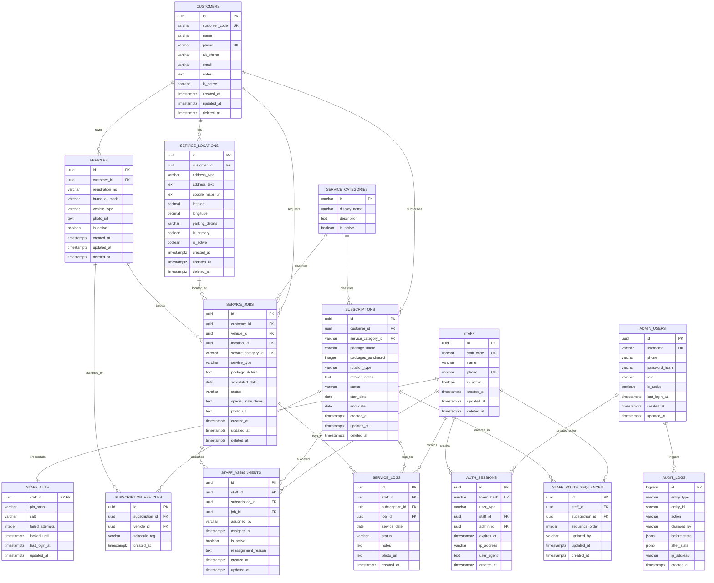

# CWP DATA APP — COMPLETE POSTGRESQL DATABASE ARCHITECTURE DESIGN
**Application Target:** Standalone CWP Customer Data App (`CWPCUSTOMERDATA`)  
**Workspace:** `D:\cwp customer data app`  
**Database Target:** Isolated Neon PostgreSQL (`cwp_customer_db`)  
**Architecture Document Version:** 1.0.0 (Phase 1C Design Milestone)  
**Status:** PROPOSED & FROZEN FOR REVIEW (Zero DDL/DML Executed)

---

## 1. Executive Summary & Design Principles

This document specifies the purpose-built PostgreSQL database architecture for the standalone **CWP Customer Data App** (`CWPCUSTOMERDATA`). 

Unlike the monolithic e-commerce and franchise management system of Cwpdetailers.in, the CWP Customer Data App has a specialized, hyper-focused operational mission:
1. **Customer & Asset Management:** Reliable management of customer identities, multi-vehicle ownership, alternate-day rotations, and physical service locations.
2. **Field Staff Dispatch & Sequence Ordering:** Providing field staff with secure, isolated mobile access to their daily cleaning routes, turn-by-turn navigation links, vehicle reference photos, and custom instructions.
3. **Multi-Service Operation:** Clear segregation between recurring Daily Car Cleaning (subscription-based) and on-demand field services (Car Washing, Solar Panel Cleaning).
4. **Zero Data Loss & Historical Preservation:** Supporting soft deletions, sequence snapshots, and full audit logging for administrative edits.

### Core Architectural Guarantees
- **Normalized Relational Model:** Eliminates comma-separated/slash-delimited vehicle registration strings and dual-address overloading present in Google Sheets.
- **Backwards API Compatibility:** Designed to cleanly map 1:1 with all existing frontend payloads consumed by `Index.html` and serviced by `server.js`.
- **Zero Monorepo Contamination:** Independent schema namespace; does not depend on, import, or borrow any tables or types from the 132-table Cwpdetailers monorepo.
- **Strict Cryptographic Security:** Replaces plaintext and legacy hashes with salted `scrypt` hashing for 6-digit staff PINs and admin passwords, with SHA-256 session token management.

---

## 2. Entity Relationship Diagram (Mermaid)



---

## 3. Complete Table Inventory

The architecture comprises exactly **15 dedicated tables** (compared to the monorepo's 132 tables), completely capturing all business rules, workflows, and operational capabilities of the standalone application:

| # | Table Name | Purpose & Business Scope |
|---|---|---|
| 1 | `customers` | Master record for customer identity, normalized phone, contact info, and status. |
| 2 | `vehicles` | Individual customer vehicles with registration number, make/model, and photo. |
| 3 | `service_locations` | Physical addresses (society, flat, landmark), GPS coordinates, map URLs, and parking notes. |
| 4 | `staff` | Field staff master data, unique staff codes (`STF01`), name, and mobile number. |
| 5 | `staff_auth` | Secure staff authentication credentials, scrypt PIN hashes, lockout tracking, and login audits. |
| 6 | `service_categories` | Reference master for service lines (`daily_car_cleaning`, `car_washing`, `solar_cleaning`). |
| 7 | `subscriptions` | Recurring Daily Car Cleaning contracts, package details, and alternate-day rotation parameters. |
| 8 | `subscription_vehicles` | Junction mapping individual vehicles to a subscription with rotation schedule tags (`aaj`, `kal`, `daily`). |
| 9 | `staff_assignments` | Active and historical staff allocations to subscriptions and on-demand service jobs. |
| 10 | `staff_route_sequences`| Daily operational dispatch stop sequences for staff with drag-and-drop manual override support. |
| 11 | `service_jobs` | Dedicated operational records for non-recurring jobs (Car Washing, Rooftop Solar Cleaning). |
| 12 | `service_logs` | Field completion records, missed service logs, rain delays, and completion verification photos. |
| 13 | `admin_users` | Administrator accounts, credentials, and management role definitions. |
| 14 | `auth_sessions` | Server-issued, revocable bearer sessions for staff mobile portals and admin dashboards (12h TTL). |
| 15 | `audit_logs` | Immutable audit trail capturing JSONB pre/post snapshots for every customer/staff update. |

---

## 4. Table-by-Table Column Specifications

### 4.1. `customers`
Master identity of every customer serviced by CWP.

| Column | Type | Nullable | Default | Constraints & Description |
|---|---|---|---|---|
| `id` | `UUID` | NO | `gen_random_uuid()` | Primary Key |
| `customer_code` | `VARCHAR(32)` | NO | — | Unique human-friendly ID (e.g. `CUST_9889960999_UP65AB`) |
| `name` | `VARCHAR(150)` | NO | — | Full customer name |
| `phone` | `VARCHAR(10)` | NO | — | Normalized 10-digit Indian mobile number (6/7/8/9 prefix) |
| `alt_phone` | `VARCHAR(15)` | YES | `NULL` | Secondary contact number if provided |
| `email` | `VARCHAR(150)` | YES | `NULL` | Optional email address |
| `notes` | `TEXT` | YES | `NULL` | General customer preferences |
| `is_active` | `BOOLEAN` | NO | `TRUE` | Operational active toggle |
| `created_at` | `TIMESTAMPTZ` | NO | `CURRENT_TIMESTAMP`| Record creation timestamp |
| `updated_at` | `TIMESTAMPTZ` | NO | `CURRENT_TIMESTAMP`| Last modification timestamp |
| `deleted_at` | `TIMESTAMPTZ` | YES | `NULL` | Soft deletion timestamp |

**Indexes & Constraints:**
- `CONSTRAINT pk_customers PRIMARY KEY (id)`
- `CONSTRAINT uq_customers_phone UNIQUE (phone)` WHERE `deleted_at IS NULL`
- `CONSTRAINT uq_customers_code UNIQUE (customer_code)`
- `INDEX idx_customers_phone (phone)`
- `INDEX idx_customers_active (is_active) WHERE deleted_at IS NULL`

---

### 4.2. `vehicles`
Stores individual physical vehicles. Normalizes multi-car strings like `UP65FS2830 / UP65FB2304` into atomic rows.

| Column | Type | Nullable | Default | Constraints & Description |
|---|---|---|---|---|
| `id` | `UUID` | NO | `gen_random_uuid()` | Primary Key |
| `customer_id` | `UUID` | NO | — | Foreign Key to `customers(id)` |
| `registration_no`| `VARCHAR(20)` | NO | — | Clean normalized registration number (e.g. `UP65FS2830`) |
| `brand_or_model` | `VARCHAR(100)` | YES | `NULL` | Make/Model (e.g. `Creta`, `Amaze`, `Baleno`) |
| `vehicle_type` | `VARCHAR(30)` | NO | `'Car'` | Classification (`Car`, `SUV`, `Hatchback`, `Sedan`, `Site`) |
| `photo_url` | `TEXT` | YES | `NULL` | Cloudinary HTTPS vehicle photo URL |
| `is_active` | `BOOLEAN` | NO | `TRUE` | Active status |
| `created_at` | `TIMESTAMPTZ` | NO | `CURRENT_TIMESTAMP`| Creation timestamp |
| `updated_at` | `TIMESTAMPTZ` | NO | `CURRENT_TIMESTAMP`| Last update timestamp |
| `deleted_at` | `TIMESTAMPTZ` | YES | `NULL` | Soft delete timestamp |

**Indexes & Constraints:**
- `CONSTRAINT pk_vehicles PRIMARY KEY (id)`
- `CONSTRAINT fk_vehicles_customer FOREIGN KEY (customer_id) REFERENCES customers(id) ON DELETE RESTRICT`
- `INDEX idx_vehicles_customer (customer_id)`
- `INDEX idx_vehicles_reg (registration_no)`

---

### 4.3. `service_locations`
Addresses and physical navigation destinations for customers. Normalizes primary vs secondary basement/parking addresses.

| Column | Type | Nullable | Default | Constraints & Description |
|---|---|---|---|---|
| `id` | `UUID` | NO | `gen_random_uuid()` | Primary Key |
| `customer_id` | `UUID` | NO | — | Foreign Key to `customers(id)` |
| `address_type` | `VARCHAR(20)` | NO | `'primary'` | Type: `'primary'`, `'secondary'`, `'parking'`, `'office'` |
| `address_text` | `TEXT` | NO | — | Society, flat number, tower, landmark |
| `google_maps_url`| `TEXT` | YES | `NULL` | Full Google Maps URL or Plus Code |
| `latitude` | `NUMERIC(10,7)`| YES | `NULL` | GPS Latitude (extracted from maps link) |
| `longitude`| `NUMERIC(10,7)`| YES | `NULL` | GPS Longitude (extracted from maps link) |
| `parking_details`| `VARCHAR(255)`| YES | `NULL` | Specific parking pillar number or basement level |
| `is_primary` | `BOOLEAN` | NO | `TRUE` | Primary dispatch destination flag |
| `is_active` | `BOOLEAN` | NO | `TRUE` | Active location status |
| `created_at` | `TIMESTAMPTZ` | NO | `CURRENT_TIMESTAMP`| Creation timestamp |
| `updated_at` | `TIMESTAMPTZ` | NO | `CURRENT_TIMESTAMP`| Last update timestamp |
| `deleted_at` | `TIMESTAMPTZ` | YES | `NULL` | Soft delete timestamp |

**Indexes & Constraints:**
- `CONSTRAINT pk_service_locations PRIMARY KEY (id)`
- `CONSTRAINT fk_locations_customer FOREIGN KEY (customer_id) REFERENCES customers(id) ON DELETE RESTRICT`
- `INDEX idx_locations_customer (customer_id)`

---

### 4.4. `staff`
Field operators and cleaning personnel master.

| Column | Type | Nullable | Default | Constraints & Description |
|---|---|---|---|---|
| `id` | `UUID` | NO | `gen_random_uuid()` | Primary Key |
| `staff_code` | `VARCHAR(20)` | NO | — | Unique staff code (e.g. `STF01`, `STF02`) |
| `name` | `VARCHAR(100)` | NO | — | Staff full name (e.g. `Chandan Soni`) |
| `phone` | `VARCHAR(10)` | NO | — | 10-digit normalized Indian mobile |
| `is_active` | `BOOLEAN` | NO | `TRUE` | Operational active status |
| `created_at` | `TIMESTAMPTZ` | NO | `CURRENT_TIMESTAMP`| Creation timestamp |
| `updated_at` | `TIMESTAMPTZ` | NO | `CURRENT_TIMESTAMP`| Last update timestamp |
| `deleted_at` | `TIMESTAMPTZ` | YES | `NULL` | Soft delete timestamp |

**Indexes & Constraints:**
- `CONSTRAINT pk_staff PRIMARY KEY (id)`
- `CONSTRAINT uq_staff_code UNIQUE (staff_code)`
- `CONSTRAINT uq_staff_phone UNIQUE (phone)` WHERE `deleted_at IS NULL`
- `INDEX idx_staff_active (is_active) WHERE deleted_at IS NULL`

---

### 4.5. `staff_auth`
Secure authentication table for staff mobile access.

| Column | Type | Nullable | Default | Constraints & Description |
|---|---|---|---|---|
| `staff_id` | `UUID` | NO | — | Primary Key & Foreign Key to `staff(id)` |
| `pin_hash` | `VARCHAR(255)`| NO | — | `scrypt` hash of the 6-digit PIN |
| `salt` | `VARCHAR(64)` | NO | — | Cryptographic salt used during hashing |
| `failed_attempts`| `INTEGER` | NO | `0` | Consecutive failed PIN attempts |
| `locked_until` | `TIMESTAMPTZ` | YES | `NULL` | Lockout expiration timestamp (after 5 failed attempts) |
| `last_login_at`| `TIMESTAMPTZ` | YES | `NULL` | Timestamp of most recent successful login |
| `updated_at` | `TIMESTAMPTZ` | NO | `CURRENT_TIMESTAMP`| Timestamp of credential update |

**Indexes & Constraints:**
- `CONSTRAINT pk_staff_auth PRIMARY KEY (staff_id)`
- `CONSTRAINT fk_staff_auth_staff FOREIGN KEY (staff_id) REFERENCES staff(id) ON DELETE CASCADE`

---

### 4.6. `service_categories`
Reference master categorizing the three operational verticals.

| Column | Type | Nullable | Default | Constraints & Description |
|---|---|---|---|---|
| `id` | `VARCHAR(30)` | NO | — | Primary Key (`daily_car_cleaning`, `car_washing`, `solar_cleaning`) |
| `display_name` | `VARCHAR(50)` | NO | — | Human-readable name (`Daily Car Cleaning`) |
| `description` | `TEXT` | YES | `NULL` | Operational scope description |
| `is_active` | `BOOLEAN` | NO | `TRUE` | Availability flag |

---

### 4.7. `subscriptions`
Recurring Daily Car Cleaning contracts. Handles package counts and alternate-day rotation rules.

| Column | Type | Nullable | Default | Constraints & Description |
|---|---|---|---|---|
| `id` | `UUID` | NO | `gen_random_uuid()` | Primary Key |
| `customer_id` | `UUID` | NO | — | Foreign Key to `customers(id)` |
| `service_category_id`| `VARCHAR(30)`| NO | `'daily_car_cleaning'`| Foreign Key to `service_categories(id)` |
| `package_name` | `VARCHAR(100)`| NO | `'Daily Clean'` | Package tier (`Daily Clean`, `Ceramic Maintenance`) |
| `packages_purchased`| `INTEGER` | NO | `1` | Number of purchased packages |
| `rotation_type`| `VARCHAR(30)` | NO | `'none'` | `'none'`, `'alternate_day_aaj_kal'`, `'multi_car'` |
| `rotation_notes`| `TEXT` | YES | `NULL` | Explicit Hindi/English instructions (e.g. `एक दिन में एक ही गाड़ी की सफाई करनी है।`) |
| `status` | `VARCHAR(20)` | NO | `'active'` | `'active'`, `'paused'`, `'cancelled'` |
| `start_date` | `DATE` | NO | `CURRENT_DATE` | Subscription activation date |
| `end_date` | `DATE` | YES | `NULL` | Expiry or termination date |
| `created_at` | `TIMESTAMPTZ` | NO | `CURRENT_TIMESTAMP`| Creation timestamp |
| `updated_at` | `TIMESTAMPTZ` | NO | `CURRENT_TIMESTAMP`| Last update timestamp |
| `deleted_at` | `TIMESTAMPTZ` | YES | `NULL` | Soft delete timestamp |

**Indexes & Constraints:**
- `CONSTRAINT pk_subscriptions PRIMARY KEY (id)`
- `CONSTRAINT fk_sub_customer FOREIGN KEY (customer_id) REFERENCES customers(id) ON DELETE RESTRICT`
- `CONSTRAINT fk_sub_category FOREIGN KEY (service_category_id) REFERENCES service_categories(id)`
- `INDEX idx_sub_customer (customer_id)`
- `INDEX idx_sub_status (status) WHERE deleted_at IS NULL`

---

### 4.8. `subscription_vehicles`
Junction table mapping individual vehicles to a subscription, specifying rotation tags.

| Column | Type | Nullable | Default | Constraints & Description |
|---|---|---|---|---|
| `id` | `UUID` | NO | `gen_random_uuid()` | Primary Key |
| `subscription_id`| `UUID` | NO | — | Foreign Key to `subscriptions(id)` |
| `vehicle_id` | `UUID` | NO | — | Foreign Key to `vehicles(id)` |
| `schedule_tag` | `VARCHAR(20)` | NO | `'daily'` | Schedule tag: `'daily'`, `'aaj'`, `'kal'`, `'alternate'` |
| `created_at` | `TIMESTAMPTZ` | NO | `CURRENT_TIMESTAMP`| Creation timestamp |

**Indexes & Constraints:**
- `CONSTRAINT pk_sub_vehicles PRIMARY KEY (id)`
- `CONSTRAINT fk_sub_veh_sub FOREIGN KEY (subscription_id) REFERENCES subscriptions(id) ON DELETE CASCADE`
- `CONSTRAINT fk_sub_veh_veh FOREIGN KEY (vehicle_id) REFERENCES vehicles(id) ON DELETE RESTRICT`
- `CONSTRAINT uq_sub_vehicle UNIQUE (subscription_id, vehicle_id)`

---

### 4.9. `staff_assignments`
Maps operational responsibility of a subscription or one-time job to a staff member. Preserves reassignment history.

| Column | Type | Nullable | Default | Constraints & Description |
|---|---|---|---|---|
| `id` | `UUID` | NO | `gen_random_uuid()` | Primary Key |
| `staff_id` | `UUID` | NO | — | Foreign Key to `staff(id)` |
| `subscription_id`| `UUID` | YES | `NULL` | Foreign Key to `subscriptions(id)` |
| `job_id` | `UUID` | YES | `NULL` | Foreign Key to `service_jobs(id)` |
| `assigned_by` | `VARCHAR(100)`| NO | `'admin'` | Administrator identity who assigned |
| `assigned_at` | `TIMESTAMPTZ` | NO | `CURRENT_TIMESTAMP`| Assignment timestamp |
| `is_active` | `BOOLEAN` | NO | `TRUE` | Active assignment flag |
| `reassignment_reason`| `TEXT` | YES | `NULL` | Audit reason if reassigned |
| `created_at` | `TIMESTAMPTZ` | NO | `CURRENT_TIMESTAMP`| Creation timestamp |
| `updated_at` | `TIMESTAMPTZ` | NO | `CURRENT_TIMESTAMP`| Last update timestamp |

**Indexes & Constraints:**
- `CONSTRAINT pk_staff_assignments PRIMARY KEY (id)`
- `CONSTRAINT fk_assign_staff FOREIGN KEY (staff_id) REFERENCES staff(id) ON DELETE RESTRICT`
- `CONSTRAINT fk_assign_sub FOREIGN KEY (subscription_id) REFERENCES subscriptions(id) ON DELETE CASCADE`
- `CONSTRAINT fk_assign_job FOREIGN KEY (job_id) REFERENCES service_jobs(id) ON DELETE CASCADE`
- `CONSTRAINT chk_assignment_target CHECK ((subscription_id IS NOT NULL AND job_id IS NULL) OR (subscription_id IS NULL AND job_id IS NOT NULL))`
- `INDEX idx_assign_staff_active (staff_id, is_active)`

---

### 4.10. `staff_route_sequences`
Maintains the exact order of stops on a staff member's daily route. Directly supports the frontend sequence editor.

| Column | Type | Nullable | Default | Constraints & Description |
|---|---|---|---|---|
| `id` | `UUID` | NO | `gen_random_uuid()` | Primary Key |
| `staff_id` | `UUID` | NO | — | Foreign Key to `staff(id)` |
| `subscription_id`| `UUID` | NO | — | Foreign Key to `subscriptions(id)` |
| `sequence_order` | `INTEGER` | NO | — | Ordinal position on route (1, 2, 3...) |
| `updated_by` | `VARCHAR(100)`| NO | `'admin'` | User who modified order |
| `updated_at` | `TIMESTAMPTZ` | NO | `CURRENT_TIMESTAMP`| Last reorder timestamp |
| `created_at` | `TIMESTAMPTZ` | NO | `CURRENT_TIMESTAMP`| Creation timestamp |

**Indexes & Constraints:**
- `CONSTRAINT pk_staff_route_sequences PRIMARY KEY (id)`
- `CONSTRAINT fk_seq_staff FOREIGN KEY (staff_id) REFERENCES staff(id) ON DELETE CASCADE`
- `CONSTRAINT fk_seq_sub FOREIGN KEY (subscription_id) REFERENCES subscriptions(id) ON DELETE CASCADE`
- `CONSTRAINT uq_staff_sub_sequence UNIQUE (staff_id, subscription_id)`
- `INDEX idx_route_order (staff_id, sequence_order)`

---

### 4.11. `service_jobs`
On-demand, non-subscription service orders (Car Washing & Solar Cleaning).

| Column | Type | Nullable | Default | Constraints & Description |
|---|---|---|---|---|
| `id` | `UUID` | NO | `gen_random_uuid()` | Primary Key |
| `customer_id` | `UUID` | NO | — | Foreign Key to `customers(id)` |
| `vehicle_id` | `UUID` | YES | `NULL` | Foreign Key to `vehicles(id)` (if car wash) |
| `location_id` | `UUID` | NO | — | Foreign Key to `service_locations(id)` |
| `service_category_id`| `VARCHAR(30)`| NO | — | Category (`car_washing` or `solar_cleaning`) |
| `service_type` | `VARCHAR(100)`| NO | — | Specific job type (`Car Washing`, `Solar Panel Cleaning`) |
| `package_details`| `TEXT` | YES | `NULL` | Service scope / capacity / details |
| `scheduled_date` | `DATE` | YES | `NULL` | Scheduled service date |
| `status` | `VARCHAR(20)` | NO | `'assigned'` | `'pending'`, `'assigned'`, `'completed'`, `'cancelled'` |
| `special_instructions`| `TEXT` | YES | `NULL` | Customer or safety instructions |
| `photo_url` | `TEXT` | YES | `NULL` | Reference site or vehicle photo |
| `created_at` | `TIMESTAMPTZ` | NO | `CURRENT_TIMESTAMP`| Creation timestamp |
| `updated_at` | `TIMESTAMPTZ` | NO | `CURRENT_TIMESTAMP`| Last update timestamp |
| `deleted_at` | `TIMESTAMPTZ` | YES | `NULL` | Soft delete timestamp |

**Indexes & Constraints:**
- `CONSTRAINT pk_service_jobs PRIMARY KEY (id)`
- `CONSTRAINT fk_jobs_customer FOREIGN KEY (customer_id) REFERENCES customers(id) ON DELETE RESTRICT`
- `CONSTRAINT fk_jobs_veh FOREIGN KEY (vehicle_id) REFERENCES vehicles(id) ON DELETE SET NULL`
- `CONSTRAINT fk_jobs_loc FOREIGN KEY (location_id) REFERENCES service_locations(id) ON DELETE RESTRICT`
- `CONSTRAINT fk_jobs_cat FOREIGN KEY (service_category_id) REFERENCES service_categories(id)`
- `INDEX idx_jobs_status (status) WHERE deleted_at IS NULL`

---

### 4.12. `service_logs`
Execution history and completion verification.

| Column | Type | Nullable | Default | Constraints & Description |
|---|---|---|---|---|
| `id` | `UUID` | NO | `gen_random_uuid()` | Primary Key |
| `staff_id` | `UUID` | NO | — | Foreign Key to `staff(id)` |
| `subscription_id`| `UUID` | YES | `NULL` | Foreign Key to `subscriptions(id)` |
| `job_id` | `UUID` | YES | `NULL` | Foreign Key to `service_jobs(id)` |
| `service_date` | `DATE` | NO | `CURRENT_DATE` | Date service was performed |
| `status` | `VARCHAR(30)` | NO | `'completed'` | `'completed'`, `'missed'`, `'customer_unavailable'`, `'rain'` |
| `notes` | `TEXT` | YES | `NULL` | Staff notes taken during visit |
| `photo_url` | `TEXT` | YES | `NULL` | Proof-of-work photo URL |
| `created_at` | `TIMESTAMPTZ` | NO | `CURRENT_TIMESTAMP`| Log creation timestamp |

**Indexes & Constraints:**
- `CONSTRAINT pk_service_logs PRIMARY KEY (id)`
- `CONSTRAINT fk_logs_staff FOREIGN KEY (staff_id) REFERENCES staff(id)`
- `INDEX idx_logs_date (service_date)`

---

### 4.13. `admin_users`
Administrative personnel login credentials and roles.

| Column | Type | Nullable | Default | Constraints & Description |
|---|---|---|---|---|
| `id` | `UUID` | NO | `gen_random_uuid()` | Primary Key |
| `username` | `VARCHAR(50)` | NO | — | Unique login username or phone |
| `phone` | `VARCHAR(10)` | YES | `NULL` | Admin phone number |
| `password_hash`| `VARCHAR(255)`| NO | — | `scrypt` hash of the admin password |
| `role` | `VARCHAR(20)` | NO | `'superadmin'` | `'superadmin'`, `'admin'`, `'viewer'` |
| `is_active` | `BOOLEAN` | NO | `TRUE` | Active account flag |
| `last_login_at`| `TIMESTAMPTZ` | YES | `NULL` | Last login timestamp |
| `created_at` | `TIMESTAMPTZ` | NO | `CURRENT_TIMESTAMP`| Creation timestamp |
| `updated_at` | `TIMESTAMPTZ` | NO | `CURRENT_TIMESTAMP`| Last update timestamp |

**Indexes & Constraints:**
- `CONSTRAINT pk_admin_users PRIMARY KEY (id)`
- `CONSTRAINT uq_admin_username UNIQUE (username)`

---

### 4.14. `auth_sessions`
Active server-side bearer sessions with 12-hour TTL and instant revocation.

| Column | Type | Nullable | Default | Constraints & Description |
|---|---|---|---|---|
| `id` | `UUID` | NO | `gen_random_uuid()` | Primary Key |
| `token_hash` | `VARCHAR(64)` | NO | — | SHA-256 hash of the bearer token string |
| `user_type` | `VARCHAR(20)` | NO | — | `'admin'` or `'staff'` |
| `staff_id` | `UUID` | YES | `NULL` | Foreign Key to `staff(id)` |
| `admin_id` | `UUID` | YES | `NULL` | Foreign Key to `admin_users(id)` |
| `expires_at` | `TIMESTAMPTZ` | NO | — | Expiration timestamp (12 hours from issuance) |
| `ip_address` | `VARCHAR(45)` | YES | `NULL` | Client IP address |
| `user_agent` | `TEXT` | YES | `NULL` | Client User-Agent string |
| `created_at` | `TIMESTAMPTZ` | NO | `CURRENT_TIMESTAMP`| Token issuance timestamp |

**Indexes & Constraints:**
- `CONSTRAINT pk_auth_sessions PRIMARY KEY (id)`
- `CONSTRAINT uq_session_token UNIQUE (token_hash)`
- `CONSTRAINT fk_sess_staff FOREIGN KEY (staff_id) REFERENCES staff(id) ON DELETE CASCADE`
- `CONSTRAINT fk_sess_admin FOREIGN KEY (admin_id) REFERENCES admin_users(id) ON DELETE CASCADE`
- `INDEX idx_session_expiry (expires_at)`

---

### 4.15. `audit_logs`
Immutable change audit log recording JSONB state before and after every modification.

| Column | Type | Nullable | Default | Constraints & Description |
|---|---|---|---|---|
| `id` | `BIGSERIAL` | NO | — | Auto-incrementing Primary Key |
| `entity_type` | `VARCHAR(50)` | NO | — | Target entity (`customer`, `vehicle`, `staff`, `subscription`, `sequence`) |
| `entity_id` | `VARCHAR(100)`| NO | — | String ID of modified entity |
| `action` | `VARCHAR(20)` | NO | — | Action: `'create'`, `'update'`, `'delete'`, `'reorder'`, `'reassign'` |
| `changed_by` | `VARCHAR(100)`| NO | — | Administrator username or staff code |
| `before_state` | `JSONB` | YES | `NULL` | Full JSON state prior to modification |
| `after_state` | `JSONB` | YES | `NULL` | Full JSON state following modification |
| `ip_address` | `VARCHAR(45)` | YES | `NULL` | IP address of caller |
| `created_at` | `TIMESTAMPTZ` | NO | `CURRENT_TIMESTAMP`| Audit log timestamp |

**Indexes & Constraints:**
- `CONSTRAINT pk_audit_logs PRIMARY KEY (id)`
- `INDEX idx_audit_entity (entity_type, entity_id)`
- `INDEX idx_audit_created (created_at)`

---

## 5. Google Sheets to PostgreSQL Mapping

The following table details the transformation logic from both Google Sheet tabs into the normalized PostgreSQL schema:

### Tab 1: `Daily Clean` (13 Source Columns)

| Sheet Col | Google Sheet Header | PostgreSQL Destination Table & Column | Transformation & Extraction Logic |
|---|---|---|---|
| **A** | `Customer Name` | `customers.name` | Trim whitespace. Sourced directly. |
| **B** | `Customer Number` | `customers.phone` | Normalized using `normalizeIndianMobile()`. Strips non-digits, `+91`, leading `0`. Validates 10-digits starting with 6/7/8/9. |
| **C** | `Google Maps URL` | `service_locations.google_maps_url`<br>`service_locations.latitude`<br>`service_locations.longitude` | Stored in `service_locations` where `is_primary = TRUE`. Regex parses `!3d<lat>!4d<lng>` or `@<lat>,<lng>` coordinates if present. |
| **D** | `Customer / Vehicle Photo URL` | `vehicles.photo_url` | Direct HTTPS URL from Google Drive / Cloudinary. Attached to the customer's primary vehicle. |
| **E** | `Address` | `service_locations.address_text` | Stored as `address_type = 'primary'`. |
| **F** | `Vehicle Number(s) / Model(s)` | `vehicles`<br>`subscription_vehicles` | Split on `/` or `&`. RegEx `\b([A-Z]{2}[ -]?[0-9]{1,2}[ -]?[A-Z]{0,3}[ -]?[0-9]{4})\b` extracts registration; remainder extracts Model. If multi-car, creates 2 `vehicles` and 2 `subscription_vehicles`. |
| **G** | `Package Type` | `subscriptions.package_name` | Defaults to `'Daily Clean'` or `'DCC ONLY'`. |
| **H** | `Packages Purchased` | `subscriptions.packages_purchased` | Parsed integer (default `1`). |
| **I** | `Staff Name` | `staff_assignments.staff_id` | Match by staff name against `staff.name`. Creates active `staff_assignments` record. If `'Unassigned'`, leaves unassigned. |
| **J** | `Staff Notes / Cleaning Instructions` | `subscriptions.rotation_notes`<br>`subscriptions.rotation_type` | If notes contain `alternate`, `Aaj`, `Kal`, or `एक दिन में एक ही गाड़ी`, sets `rotation_type = 'alternate_day_aaj_kal'`. |
| **K** | `Secondary Address (if any)` | `service_locations.address_text` | Inserted as second `service_locations` row with `address_type = 'secondary'` and `is_primary = FALSE`. |
| **L** | `Secondary Maps URL` | `service_locations.google_maps_url` | Attached to the secondary `service_locations` record. |
| **M** | `Active` | `customers.is_active`<br>`subscriptions.status` | `'Yes'` -> `is_active = TRUE`, `status = 'active'`. `'No'` -> `is_active = FALSE`, `status = 'paused'`. |

### Tab 2: `All Other Work` (11 Source Columns)

| Sheet Col | Google Sheet Header | PostgreSQL Destination Table & Column | Transformation & Extraction Logic |
|---|---|---|---|
| **A** | `Customer Name` | `customers.name` | Customer record matched by normalized phone or created fresh. |
| **B** | `Customer Number` | `customers.phone` | Normalized 10-digit mobile. |
| **C** | `Google Maps URL` | `service_locations.google_maps_url` | Primary location Google Maps URL. |
| **D** | `Vehicle / Site Photo URL` | `service_jobs.photo_url`<br>`vehicles.photo_url` | Sourced directly. |
| **E** | `Address` | `service_locations.address_text` | Site address. |
| **F** | `Service Type (Car Wash / Solar Cleaning)` | `service_jobs.service_category_id`<br>`service_jobs.service_type` | If contains `'Solar'` -> category `'solar_cleaning'`. If contains `'Car'` or `'Wash'` -> category `'car_washing'`. |
| **G** | `Vehicle Number / Site Name` | `vehicles.registration_no` OR `service_jobs.special_instructions` | If automotive registration regex matches, creates `vehicles` record; otherwise stores as site name in instructions. |
| **H** | `Package / Service Details` | `service_jobs.package_details` | Service scope text. |
| **I** | `Staff Name` | `staff_assignments.staff_id` | Sourced by name matching to `staff.name`. |
| **J** | `Staff Notes / Special Instructions` | `service_jobs.special_instructions` | Operational notes. |
| **K** | `Active` | `service_jobs.status` | `'Yes'` -> `'assigned'`, `'No'` -> `'cancelled'`. |

---

## 6. Real-World Data Edge Cases Handled

During forensic inspection of the 51 active Google Sheets records, four specific edge cases were analyzed and solved:

1. **Alternate-Day Hindi Rotation Directives:**
   - *Example:* Customer `अपूर्व मित्तल`, Vehicle `UP65FS2830 / UP65FB2304`, Notes: `एक दिन में एक ही गाड़ी की सफाई करनी है।`
   - *Architecture Handling:* 
     - Creates 2 distinct rows in `vehicles` (`UP65FS2830` and `UP65FB2304`).
     - Creates 1 `subscriptions` row with `packages_purchased = 1`, `rotation_type = 'alternate_day_aaj_kal'`, and stores the original Hindi instruction in `rotation_notes`.
     - Links both cars via `subscription_vehicles` with schedule tags `aaj` and `kal`.
2. **Dual Parking / Multi-Location Customers:**
   - *Example:* Customer `सिद्धार्थ सिंह बिसेन`, Primary Location (Society), Secondary Location: `ऑफिस लोकेशन`.
   - *Architecture Handling:* Creates 2 relational records in `service_locations`:
     - Row 1: `is_primary = TRUE`, `address_type = 'primary'`.
     - Row 2: `is_primary = FALSE`, `address_type = 'secondary'`, text: `'ऑफिस लोकेशन'`.
3. **Unassigned Customers (7 records):**
   - *Architecture Handling:* Subscriptions and service jobs allow NULL active assignments; customers are placed in the unassigned dispatch pool.
4. **Order Preservation & Route Sequences:**
   - Existing staff route sequence numbers in `staffSequences` (`STF01`, `STF02`) map 1:1 into `staff_route_sequences(sequence_order)`, preserving the precise dispatch order seen on staff smartphones.

---

## 7. Migration Sequence & Execution Strategy

When authorized, migration will execute in strict dependency order within a single atomic database transaction:

```
[Step 1: Reference Data]
    ├── Insert service_categories ('daily_car_cleaning', 'car_washing', 'solar_cleaning')
    └── Insert initial admin_users (Superadmin account)

[Step 2: Staff Master]
    ├── Insert staff (STF01, STF02)
    └── Insert staff_auth (Migrate scrypt PIN hashes & display PINs from local_data.json)

[Step 3: Customer Master]
    ├── Normalize & deduplicate customer identities across both tabs
    └── Insert customers (Generates stable UUIDs and human-readable codes)

[Step 4: Location & Asset Master]
    ├── Insert primary service_locations (Extract GPS lat/lng)
    ├── Insert secondary service_locations (basement/office locations)
    └── Insert vehicles (Parse registrations, models, and attach Cloudinary photo URLs)

[Step 5: Operational Subscriptions & Jobs]
    ├── Insert Daily Clean records into subscriptions
    ├── Insert junction rows into subscription_vehicles (tagging 'aaj', 'kal', 'daily')
    └── Insert All Other Work records into service_jobs

[Step 6: Staff Allocations & Dispatch Sequences]
    ├── Insert active staff_assignments
    └── Insert staff_route_sequences (Migrating exact custom order from appState.staffSequences)

[Step 7: Verification & Audit Baseline]
    ├── Verify customer count == 51
    ├── Verify vehicle count >= 53
    ├── Verify staff sequence count matches active DCC jobs
    └── Log baseline migration snapshot into audit_logs
```

---

## 8. Backend Application Architecture Proposal

To cleanly support this database while maintaining full frontend compatibility with `Index.html`:

```
┌────────────────────────────────────────────────────────┐
│             Frontend UI (Index.html)                   │
│   Staff Mobile Portal  │  Admin Control Dashboard      │
└──────────────────────────┬─────────────────────────────┘
                           │ HTTP POST /api (JSON)
┌──────────────────────────▼─────────────────────────────┐
│             Node.js Backend (server.js)                │
│  Session Middleware  │  Rate Limiting  │ Auth Guard    │
├────────────────────────────────────────────────────────┤
│                    Service Layer                       │
│  CustomerService  │  StaffService  │  DispatchService  │
├────────────────────────────────────────────────────────┤
│                   Repository Layer                     │
│  CustomerRepo  │  VehicleRepo  │  StaffRepo  │ JobRepo │
├────────────────────────────────────────────────────────┤
│                 Database Access Layer                  │
│  neon-db.js (pg.Pool Connection Pooling with SSL)      │
└──────────────────────────┬─────────────────────────────┘
                           │ SQL Queries (Parameterized)
┌──────────────────────────▼─────────────────────────────┐
│          Neon PostgreSQL (cwp_customer_db)             │
└────────────────────────────────────────────────────────┘
```

### Backwards Compatible API Translation
The existing frontend expects responses in specific formats (e.g. `dailyCarCleaning` array containing combined vehicle and secondary address strings). 

The `DispatchService` will construct the exact JSON format expected by `Index.html`:
- Projections will synthesize `vehicle` as `"UP65FS2830 / UP65FB2304"` and populate `secondaryAddress`, `notes`, `customerNumber`, and `googleMapsUrl`.
- Frontend code will require **zero changes**, ensuring a completely transparent transition for field staff and administrators.

---

## 9. Security, Authentication & Session Design

1. **Staff Mobile Authentication:**
   - Staff enter 6-digit numeric PIN.
   - Verified server-side via `crypto.scrypt` with a unique 16-byte cryptographic salt.
   - Failed attempts tracked in `staff_auth`. 5 consecutive failures triggers a 5-minute lockout.
   - Successful authentication issues a cryptographically secure random token (32 bytes hex), hashed with SHA-256 and stored in `auth_sessions` with a 12-hour expiration.
2. **Staff Data Isolation:**
   - When a staff member invokes `getStaffData`, their bearer token is validated.
   - The query filters solely on `staff_assignments.staff_id = session.staff_id`.
   - Access to unassigned customers or other staff members' routes is strictly rejected (`403 Forbidden`).
3. **Admin Dashboard Security:**
   - Admin authentication verifies against `admin_users.password_hash` using `scrypt`.
   - Admin sessions possess elevated privileges (`role = 'superadmin'`), allowing staff PIN reveal/reset, sequence reordering, and customer editing.
4. **Audit Logging:**
   - Every mutation (`saveCustomer`, `updateCustomer`, `saveStaffSequence`, `resetStaffPin`) writes an entry to `audit_logs` containing user identity, IP address, timestamp, and pre/post JSONB snapshots.

---

## 10. Testing, Verification & Rollback Strategy

1. **Dual-Read Shadow Mode (Phase 2):**
   - The backend will read from PostgreSQL while keeping Google Sheets synchronization active.
   - A reconciliation comparator will verify that Google Sheets and PostgreSQL return identical customer counts, phone numbers, and sequence orders.
2. **Rollback Plan:**
   - Because Google Sheets remains active during initial phases, reverting to Sheets is as simple as flipping an environment flag: `DB_PROVIDER=sheets` or `DISABLE_LIVE_SHEETS=false`.
   - No data will be lost, and field staff mobile operations will continue uninterrupted.

---

## 11. Risks & Business Decision Log

| Risk / Question | Analysis | Proposed Architectural Decision |
|---|---|---|
| **Ambiguous Multiple Vehicles:** | Some rows list vehicles as `"UP65 BB 7820 / UP65 EM 7570"` without specifying models. | Parser creates 2 vehicle records, tagging registration strings and setting generic model type until edited in admin. |
| **Route Ordering Inconsistencies:** | What happens when a new customer is added to a staff member with a custom sequence? | New customer is automatically appended at `MAX(sequence_order) + 1` to prevent route disruptions. |
| **Offline Staff Capabilities:** | Field staff occasionally encounter poor cell reception in basement parkings. | `Index.html` client-side caching using ETag / version headers is fully preserved via `computeStaffDataVersion()`. |

---

## 12. Conclusion & Next Step

This architecture provides a clean, normalized, robust foundation designed specifically for `CWPCUSTOMERDATA`.

- **Current State:** Neon database `cwp_customer_db` is verified empty (0 tables).
- **Deliverable File:** `docs/architecture/CWP_DATA_APP_DATABASE_ARCHITECTURE.md`
- **Next Step:** Awaiting explicit administrative approval before authoring any migration scripts or schema DDL.
