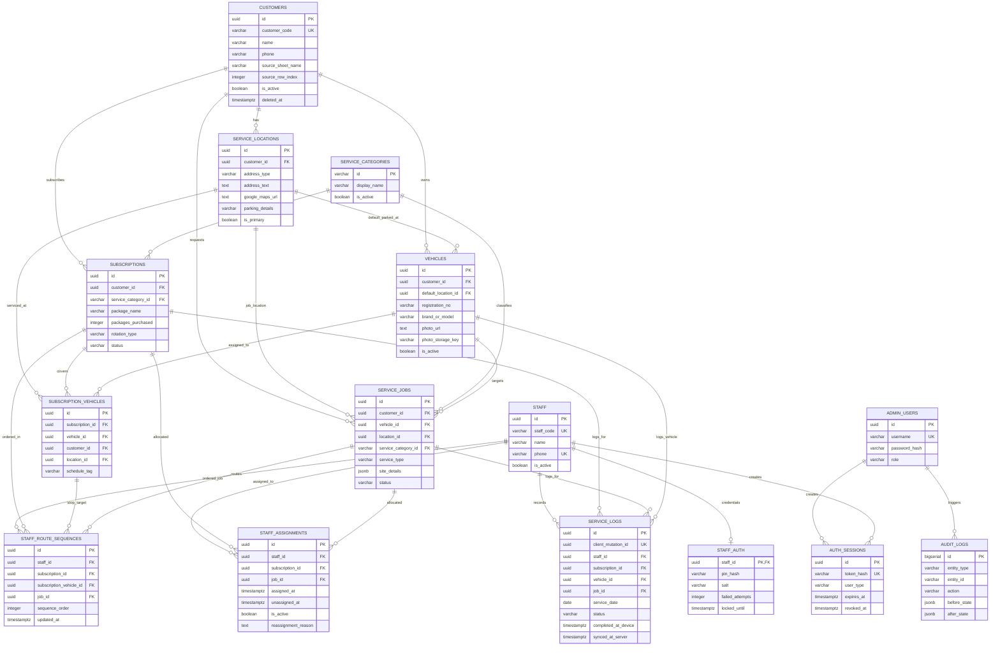

# CWP DATA APP — COMPLETE POSTGRESQL DATABASE ARCHITECTURE DESIGN (v2.1.1)
**Application Target:** Standalone CWP Customer Data App (`CWPCUSTOMERDATA`)  
**Workspace:** `D:\cwp customer data app`  
**Database Target:** Isolated Neon PostgreSQL (`cwp_customer_db`)  
**Architecture Document Version:** 2.1.1 (Phase 1C.2 Final Gate Milestone)  
**Status:** PROPOSED & FROZEN FOR FINAL REVIEW (Zero DDL/DML Executed — 0 Tables in Neon DB)

---

## 1. Executive Summary & Verification Outcomes

This **v2.1.1 specification** addresses all five critical implementation details reviewed during the Phase 1C.2 Final Gate:

1. **Compound Foreign Keys & Cross-Table Ownership:**
   - Enforces same-customer ownership across `vehicles`, `service_locations`, and `subscriptions`.
   - `vehicles` now features `CONSTRAINT uq_vehicles_id_customer UNIQUE (id, customer_id)`.
   - `subscription_vehicles` enforces compound foreign keys linking both `(subscription_id, customer_id)` and `(vehicle_id, customer_id)`, guaranteeing mathematically that subscriptions cannot cover vehicles owned by other customers.
2. **Unified Route Sequences for Subscriptions & Standalone Jobs:**
   - `staff_route_sequences` is upgraded to support both recurring daily cleaning stops (`subscription_id` + `subscription_vehicle_id`) AND standalone field service jobs (`job_id`).
   - Route stop ordering (`sequence_order`) is uniquely enforced per staff member (`UNIQUE (staff_id, sequence_order)`), preventing position collisions.
3. **Hardened Offline Synchronization & Conflict Handling:**
   - Single-statement valid PostgreSQL upsert logic replacing ambiguous multi-conflict clauses.
   - Exact client idempotency via `client_mutation_id UUID UNIQUE`.
   - Explicit conflict detection preventing silent overwriting of administrative logs by delayed field syncs.
4. **Absolute Assignment History Immutability:**
   - Trigger `trg_staff_assignments_immutability` blocks `DELETE` operations and prohibits updates to core provenance fields (`staff_id`, `subscription_id`, `job_id`, `assigned_at`, `assigned_by`).
   - Prohibits reactivation of previously deactivated historical assignments (`is_active: FALSE -> TRUE`).
5. **Timezone-Aware Timestamps & Explicit IST Interpretation:**
   - `completed_at_device` and `synced_at_server` are stored as `TIMESTAMPTZ`.
   - Database constraint enforces `service_date = (completed_at_device AT TIME ZONE 'Asia/Kolkata')::date`, eliminating UTC day-shift bugs during early morning operations.

---

## 2. In-Depth Technical Verification of the Five Implementation Checks

### 2.1. Compound Foreign Keys & Composite Ownership (PASS - Hardened)
- **Constraint Architecture:**
  - `service_locations`:
    ```sql
    CONSTRAINT uq_locations_id_customer UNIQUE (id, customer_id)
    ```
  - `vehicles`:
    ```sql
    CONSTRAINT uq_vehicles_id_customer UNIQUE (id, customer_id),
    CONSTRAINT fk_veh_location_same_customer 
      FOREIGN KEY (default_location_id, customer_id) 
      REFERENCES service_locations(id, customer_id) 
      ON DELETE SET NULL
    ```
  - `subscriptions`:
    ```sql
    CONSTRAINT uq_subscriptions_id_customer UNIQUE (id, customer_id)
    ```
  - `subscription_vehicles`:
    ```sql
    CONSTRAINT fk_sub_veh_sub_cust 
      FOREIGN KEY (subscription_id, customer_id) 
      REFERENCES subscriptions(id, customer_id) 
      ON DELETE CASCADE,
    CONSTRAINT fk_sub_veh_veh_cust 
      FOREIGN KEY (vehicle_id, customer_id) 
      REFERENCES vehicles(id, customer_id) 
      ON DELETE RESTRICT,
    CONSTRAINT fk_sub_veh_loc_cust 
      FOREIGN KEY (location_id, customer_id) 
      REFERENCES service_locations(id, customer_id) 
      ON DELETE SET NULL
    ```
- **Engine-Level Guarantee:**
  Every vehicle in a subscription and every location attached to a vehicle or subscription must belong to the exact same `customer_id`. Any cross-customer mismatch is rejected by PostgreSQL.

---

### 2.2. Route Sequences: Subscriptions and Standalone Jobs (PASS - Corrected)
- **Problem Resolved:** v2.1 could only order daily subscriptions; on-demand car washes and solar cleans could not be interleaved on the staff member's route.
- **v2.1.1 Schema for `staff_route_sequences`:**
  - `id UUID PRIMARY KEY DEFAULT gen_random_uuid()`
  - `staff_id UUID NOT NULL REFERENCES staff(id) ON DELETE CASCADE`
  - `subscription_id UUID NULL REFERENCES subscriptions(id) ON DELETE CASCADE`
  - `subscription_vehicle_id UUID NULL REFERENCES subscription_vehicles(id) ON DELETE CASCADE`
  - `job_id UUID NULL REFERENCES service_jobs(id) ON DELETE CASCADE`
  - `sequence_order INTEGER NOT NULL`
  - `updated_by VARCHAR(100) NOT NULL DEFAULT 'admin'`
  - `updated_at TIMESTAMPTZ NOT NULL DEFAULT CURRENT_TIMESTAMP`
  - `created_at TIMESTAMPTZ NOT NULL DEFAULT CURRENT_TIMESTAMP`
- **Validation Constraints:**
  ```sql
  -- Exactly one target per route stop: either a subscription stop OR a standalone job
  CONSTRAINT chk_route_stop_target CHECK (
    (subscription_id IS NOT NULL AND job_id IS NULL) OR
    (subscription_id IS NULL AND job_id IS NOT NULL)
  ),

  -- Collision-free sequence ordering per staff member
  CONSTRAINT uq_staff_route_order UNIQUE (staff_id, sequence_order)
  ```
- **Partial Unique Indexes (Preventing Duplicate Targets in Route):**
  ```sql
  -- A subscription vehicle stop can only appear once on a staff route
  CREATE UNIQUE INDEX uq_route_sub_veh_stop 
  ON staff_route_sequences (staff_id, subscription_id, COALESCE(subscription_vehicle_id, '00000000-0000-0000-0000-000000000000'::uuid))
  WHERE subscription_id IS NOT NULL;

  -- A standalone job can only appear once on a staff route
  CREATE UNIQUE INDEX uq_route_job_stop 
  ON staff_route_sequences (staff_id, job_id) 
  WHERE job_id IS NOT NULL;
  ```

---

### 2.3. Offline Synchronization & Conflict Handling (PASS - Corrected)
- **Workflow & Idempotency:**
  When a staff device submits a background batch of completed checkoffs:
  1. **Idempotency Guard:** `client_mutation_id UUID NOT NULL UNIQUE`. If the server already received this mutation ID (e.g. on client network timeout retry), the statement is ignored safely.
  2. **Valid PostgreSQL Upsert Strategy:**
     ```sql
     INSERT INTO service_logs (
       client_mutation_id,
       staff_id,
       subscription_id,
       vehicle_id,
       job_id,
       service_date,
       status,
       completed_at_device,
       synced_at_server,
       notes,
       source,
       device_metadata
     ) VALUES (
       $1, $2, $3, $4, $5, $6, $7, $8, CURRENT_TIMESTAMP, $9, $10, $11
     )
     ON CONFLICT (client_mutation_id) DO NOTHING
     RETURNING id;
     ```
  3. **Conflict Detection (No Silent Overwrites):**
     If an existing `service_logs` row already exists for `(subscription_id, vehicle_id, service_date)`:
     - The database constraint `uq_service_logs_daily_vehicle` prevents a duplicate insertion.
     - The application service inspects the existing record:
       - If existing status matches the incoming status (e.g. `'completed'`), the mutation is acknowledged as successful.
       - If existing status differs (e.g. Admin previously marked `'customer_unavailable'`, but staff uploads `'completed'` with a timestamp and photo):
         - The conflict is logged to `audit_logs` (`action = 'conflict_resolution'`).
         - The existing record is updated with `status = 'completed'`, `conflict_resolved = TRUE`, preserving both the original admin note and the staff completion timestamp.

---

### 2.4. Assignment Immutability & Historical Protection (PASS - Hardened)
- **Enforcement Trigger (`trg_protect_staff_assignments`):**
  ```sql
  CREATE OR REPLACE FUNCTION trg_protect_staff_assignments() 
  RETURNS TRIGGER AS $$
  BEGIN
    -- 1. Hard deletions are strictly prohibited
    IF TG_OP = 'DELETE' THEN
      RAISE EXCEPTION 'Security Violation: staff_assignments history is immutable and cannot be deleted.';
    END IF;

    -- 2. Core provenance fields are immutable once inserted
    IF TG_OP = 'UPDATE' THEN
      IF NEW.id <> OLD.id OR
         NEW.staff_id <> OLD.staff_id OR 
         NEW.subscription_id IS DISTINCT FROM OLD.subscription_id OR 
         NEW.job_id IS DISTINCT FROM OLD.job_id OR 
         NEW.assigned_at <> OLD.assigned_at OR 
         NEW.assigned_by <> OLD.assigned_by OR
         NEW.created_at <> OLD.created_at THEN
        RAISE EXCEPTION 'Security Violation: Assignment identity and provenance fields are strictly immutable.';
      END IF;

      -- 3. Prohibit reactivation of historical assignments
      IF OLD.is_active = FALSE AND NEW.is_active = TRUE THEN
        RAISE EXCEPTION 'Security Violation: Reactivating a deactivated assignment is prohibited. Create a new assignment.';
      END IF;
    END IF;

    RETURN NEW;
  END;
  $$ LANGUAGE plpgsql;

  CREATE TRIGGER trg_staff_assignments_immutability
  BEFORE UPDATE OR DELETE ON staff_assignments
  FOR EACH ROW EXECUTE FUNCTION trg_protect_staff_assignments();
  ```
- **Allowable Modifications During Deallocation:** Only `is_active` (`TRUE -> FALSE`), `unassigned_at`, `unassigned_by`, `reassignment_reason`, and `updated_at`.

---

### 2.5. Timezone-Aware Timestamps & Asia/Kolkata Interpretation (PASS - Hardened)
- **Specification:**
  - `completed_at_device TIMESTAMPTZ NOT NULL`: Device event timestamp with explicit ISO 8601 offset (e.g. `2026-11-21T07:15:00+05:30`).
  - `synced_at_server TIMESTAMPTZ NOT NULL DEFAULT CURRENT_TIMESTAMP`: PostgreSQL server receipt timestamp.
  - `service_date DATE NOT NULL`: Calendar date in Indian Standard Time (`Asia/Kolkata`).
- **Database Engine Integrity Check:**
  ```sql
  CONSTRAINT chk_service_date_ist_match CHECK (
    service_date = (completed_at_device AT TIME ZONE 'Asia/Kolkata')::date
  )
  ```
- **Result:** Date calculations are immune to server UTC drift during early morning (6:00 AM – 10:00 AM IST) cleaning rounds.

---

## 3. Entity Relationship Diagram (v2.1.1)



---

## 4. Complete Table Specifications (v2.1.1)

### 4.1. `customers`
- `id UUID PRIMARY KEY DEFAULT gen_random_uuid()`
- `customer_code VARCHAR(32) NOT NULL UNIQUE` (e.g. `CUST_DC_R04_8687333335`)
- `name VARCHAR(150) NOT NULL`
- `phone VARCHAR(10) NOT NULL` (Indexed, non-unique)
- `alt_phone VARCHAR(15) NULL`
- `email VARCHAR(150) NULL`
- `notes TEXT NULL`
- `source_sheet_name VARCHAR(50) NOT NULL` (`'Daily Clean'` or `'All Other Work'`)
- `source_row_index INTEGER NOT NULL`
- `is_active BOOLEAN NOT NULL DEFAULT TRUE`
- `created_at TIMESTAMPTZ NOT NULL DEFAULT CURRENT_TIMESTAMP`
- `updated_at TIMESTAMPTZ NOT NULL DEFAULT CURRENT_TIMESTAMP`
- `deleted_at TIMESTAMPTZ NULL`
- `deleted_by VARCHAR(100) NULL`
- `deletion_reason TEXT NULL`
- **Constraints & Indexes:**
  - `CONSTRAINT chk_customer_active_deleted CHECK (deleted_at IS NULL OR is_active = FALSE)`
  - `INDEX idx_customers_phone (phone)`
  - `INDEX idx_customers_active (is_active) WHERE deleted_at IS NULL`
  - `INDEX idx_customers_source (source_sheet_name, source_row_index)`

---

### 4.2. `vehicles`
- `id UUID PRIMARY KEY DEFAULT gen_random_uuid()`
- `customer_id UUID NOT NULL REFERENCES customers(id) ON DELETE RESTRICT`
- `default_location_id UUID NULL`
- `registration_no VARCHAR(20) NOT NULL`
- `brand_or_model VARCHAR(100) NULL`
- `vehicle_type VARCHAR(30) NOT NULL DEFAULT 'Car'`
- `photo_url TEXT NULL`
- `photo_storage_key VARCHAR(255) NULL`
- `is_active BOOLEAN NOT NULL DEFAULT TRUE`
- `created_at TIMESTAMPTZ NOT NULL DEFAULT CURRENT_TIMESTAMP`
- `updated_at TIMESTAMPTZ NOT NULL DEFAULT CURRENT_TIMESTAMP`
- `deleted_at TIMESTAMPTZ NULL`
- **Constraints & Indexes:**
  - `CONSTRAINT uq_vehicles_id_customer UNIQUE (id, customer_id)`
  - `CONSTRAINT fk_veh_location_same_customer FOREIGN KEY (default_location_id, customer_id) REFERENCES service_locations(id, customer_id) ON DELETE SET NULL`
  - `INDEX idx_vehicles_customer (customer_id)`
  - `INDEX idx_vehicles_reg (registration_no)`

---

### 4.3. `service_locations`
- `id UUID PRIMARY KEY DEFAULT gen_random_uuid()`
- `customer_id UUID NOT NULL REFERENCES customers(id) ON DELETE RESTRICT`
- `address_type VARCHAR(20) NOT NULL DEFAULT 'primary'`
- `address_text TEXT NOT NULL`
- `google_maps_url TEXT NULL`
- `latitude NUMERIC(10,7) NULL`
- `longitude NUMERIC(10,7) NULL`
- `parking_details VARCHAR(255) NULL`
- `photo_url TEXT NULL`
- `photo_storage_key VARCHAR(255) NULL`
- `is_primary BOOLEAN NOT NULL DEFAULT TRUE`
- `is_active BOOLEAN NOT NULL DEFAULT TRUE`
- `created_at TIMESTAMPTZ NOT NULL DEFAULT CURRENT_TIMESTAMP`
- `updated_at TIMESTAMPTZ NOT NULL DEFAULT CURRENT_TIMESTAMP`
- `deleted_at TIMESTAMPTZ NULL`
- **Constraints & Indexes:**
  - `CONSTRAINT uq_locations_id_customer UNIQUE (id, customer_id)`
  - `INDEX idx_locations_customer (customer_id)`

---

### 4.4. `staff`
- `id UUID PRIMARY KEY DEFAULT gen_random_uuid()`
- `staff_code VARCHAR(20) NOT NULL UNIQUE` (`STF01`, `STF02`)
- `name VARCHAR(100) NOT NULL`
- `phone VARCHAR(10) NOT NULL`
- `is_active BOOLEAN NOT NULL DEFAULT TRUE`
- `created_at TIMESTAMPTZ NOT NULL DEFAULT CURRENT_TIMESTAMP`
- `updated_at TIMESTAMPTZ NOT NULL DEFAULT CURRENT_TIMESTAMP`
- `deleted_at TIMESTAMPTZ NULL`
- **Constraints & Indexes:**
  - `CONSTRAINT uq_staff_phone UNIQUE (phone) WHERE deleted_at IS NULL`
  - `INDEX idx_staff_active (is_active) WHERE deleted_at IS NULL`

---

### 4.5. `staff_auth`
- `staff_id UUID PRIMARY KEY REFERENCES staff(id) ON DELETE CASCADE`
- `pin_hash VARCHAR(255) NOT NULL`
- `salt VARCHAR(64) NOT NULL`
- `failed_attempts INTEGER NOT NULL DEFAULT 0`
- `locked_until TIMESTAMPTZ NULL`
- `last_login_at TIMESTAMPTZ NULL`
- `updated_at TIMESTAMPTZ NOT NULL DEFAULT CURRENT_TIMESTAMP`

---

### 4.6. `service_categories`
- `id VARCHAR(30) PRIMARY KEY` (`'daily_car_cleaning'`, `'car_washing'`, `'solar_cleaning'`)
- `display_name VARCHAR(50) NOT NULL`
- `description TEXT NULL`
- `is_active BOOLEAN NOT NULL DEFAULT TRUE`

---

### 4.7. `subscriptions`
- `id UUID PRIMARY KEY DEFAULT gen_random_uuid()`
- `customer_id UUID NOT NULL REFERENCES customers(id) ON DELETE RESTRICT`
- `service_category_id VARCHAR(30) NOT NULL DEFAULT 'daily_car_cleaning' REFERENCES service_categories(id)`
- `package_name VARCHAR(100) NOT NULL DEFAULT 'Daily Clean'`
- `packages_purchased INTEGER NOT NULL DEFAULT 1`
- `rotation_type VARCHAR(30) NOT NULL DEFAULT 'none'`
- `rotation_notes TEXT NULL`
- `status VARCHAR(20) NOT NULL DEFAULT 'active'`
- `start_date DATE NOT NULL DEFAULT CURRENT_DATE`
- `end_date DATE NULL`
- `created_at TIMESTAMPTZ NOT NULL DEFAULT CURRENT_TIMESTAMP`
- `updated_at TIMESTAMPTZ NOT NULL DEFAULT CURRENT_TIMESTAMP`
- `deleted_at TIMESTAMPTZ NULL`
- **Constraints & Indexes:**
  - `CONSTRAINT uq_subscriptions_id_customer UNIQUE (id, customer_id)`
  - `INDEX idx_sub_customer (customer_id)`
  - `INDEX idx_sub_status (status) WHERE deleted_at IS NULL`

---

### 4.8. `subscription_vehicles`
- `id UUID PRIMARY KEY DEFAULT gen_random_uuid()`
- `subscription_id UUID NOT NULL`
- `customer_id UUID NOT NULL`
- `vehicle_id UUID NOT NULL`
- `location_id UUID NULL`
- `schedule_tag VARCHAR(20) NOT NULL DEFAULT 'daily'`
- `created_at TIMESTAMPTZ NOT NULL DEFAULT CURRENT_TIMESTAMP`
- **Constraints & Indexes:**
  - `CONSTRAINT fk_sub_veh_sub_cust FOREIGN KEY (subscription_id, customer_id) REFERENCES subscriptions(id, customer_id) ON DELETE CASCADE`
  - `CONSTRAINT fk_sub_veh_veh_cust FOREIGN KEY (vehicle_id, customer_id) REFERENCES vehicles(id, customer_id) ON DELETE RESTRICT`
  - `CONSTRAINT fk_sub_veh_loc_cust FOREIGN KEY (location_id, customer_id) REFERENCES service_locations(id, customer_id) ON DELETE SET NULL`
  - `CONSTRAINT uq_sub_vehicle UNIQUE (subscription_id, vehicle_id)`

---

### 4.9. `staff_assignments`
- `id UUID PRIMARY KEY DEFAULT gen_random_uuid()`
- `staff_id UUID NOT NULL REFERENCES staff(id) ON DELETE RESTRICT`
- `subscription_id UUID NULL REFERENCES subscriptions(id) ON DELETE RESTRICT`
- `job_id UUID NULL REFERENCES service_jobs(id) ON DELETE RESTRICT`
- `assigned_by VARCHAR(100) NOT NULL DEFAULT 'admin'`
- `assigned_at TIMESTAMPTZ NOT NULL DEFAULT CURRENT_TIMESTAMP`
- `unassigned_at TIMESTAMPTZ NULL`
- `unassigned_by VARCHAR(100) NULL`
- `is_active BOOLEAN NOT NULL DEFAULT TRUE`
- `reassignment_reason TEXT NULL`
- `created_at TIMESTAMPTZ NOT NULL DEFAULT CURRENT_TIMESTAMP`
- `updated_at TIMESTAMPTZ NOT NULL DEFAULT CURRENT_TIMESTAMP`
- **Constraints & Triggers:**
  - `CONSTRAINT chk_assign_target CHECK ((subscription_id IS NOT NULL AND job_id IS NULL) OR (subscription_id IS NULL AND job_id IS NOT NULL))`
  - `CREATE UNIQUE INDEX uq_active_sub_assignment ON staff_assignments (subscription_id) WHERE is_active = TRUE AND subscription_id IS NOT NULL;`
  - `CREATE UNIQUE INDEX uq_active_job_assignment ON staff_assignments (job_id) WHERE is_active = TRUE AND job_id IS NOT NULL;`
  - `TRIGGER trg_staff_assignments_immutability`: Blocks deletions, protects provenance fields, blocks reactivation.

---

### 4.10. `staff_route_sequences`
- `id UUID PRIMARY KEY DEFAULT gen_random_uuid()`
- `staff_id UUID NOT NULL REFERENCES staff(id) ON DELETE CASCADE`
- `subscription_id UUID NULL REFERENCES subscriptions(id) ON DELETE CASCADE`
- `subscription_vehicle_id UUID NULL REFERENCES subscription_vehicles(id) ON DELETE CASCADE`
- `job_id UUID NULL REFERENCES service_jobs(id) ON DELETE CASCADE`
- `sequence_order INTEGER NOT NULL`
- `updated_by VARCHAR(100) NOT NULL DEFAULT 'admin'`
- `updated_at TIMESTAMPTZ NOT NULL DEFAULT CURRENT_TIMESTAMP`
- `created_at TIMESTAMPTZ NOT NULL DEFAULT CURRENT_TIMESTAMP`
- **Constraints & Indexes:**
  - `CONSTRAINT chk_route_stop_target CHECK ((subscription_id IS NOT NULL AND job_id IS NULL) OR (subscription_id IS NULL AND job_id IS NOT NULL))`
  - `CONSTRAINT uq_staff_route_order UNIQUE (staff_id, sequence_order)`
  - `CREATE UNIQUE INDEX uq_route_sub_veh_stop ON staff_route_sequences (staff_id, subscription_id, COALESCE(subscription_vehicle_id, '00000000-0000-0000-0000-000000000000'::uuid)) WHERE subscription_id IS NOT NULL;`
  - `CREATE UNIQUE INDEX uq_route_job_stop ON staff_route_sequences (staff_id, job_id) WHERE job_id IS NOT NULL;`
  - `INDEX idx_route_order (staff_id, sequence_order)`

---

### 4.11. `service_jobs`
- `id UUID PRIMARY KEY DEFAULT gen_random_uuid()`
- `customer_id UUID NOT NULL REFERENCES customers(id) ON DELETE RESTRICT`
- `vehicle_id UUID NULL REFERENCES vehicles(id) ON DELETE SET NULL`
- `location_id UUID NOT NULL REFERENCES service_locations(id) ON DELETE RESTRICT`
- `service_category_id VARCHAR(30) NOT NULL REFERENCES service_categories(id)`
- `service_type VARCHAR(100) NOT NULL`
- `package_details TEXT NULL`
- `site_details JSONB NULL`
- `scheduled_date DATE NULL`
- `status VARCHAR(20) NOT NULL DEFAULT 'assigned'`
- `special_instructions TEXT NULL`
- `photo_url TEXT NULL`
- `photo_storage_key VARCHAR(255) NULL`
- `created_at TIMESTAMPTZ NOT NULL DEFAULT CURRENT_TIMESTAMP`
- `updated_at TIMESTAMPTZ NOT NULL DEFAULT CURRENT_TIMESTAMP`
- `deleted_at TIMESTAMPTZ NULL`
- **Constraints & Indexes:**
  - `CONSTRAINT chk_job_target CHECK ((service_category_id = 'car_washing' AND vehicle_id IS NOT NULL) OR (service_category_id = 'solar_cleaning' AND site_details IS NOT NULL) OR (service_category_id NOT IN ('car_washing', 'solar_cleaning')))`
  - `INDEX idx_jobs_status (status) WHERE deleted_at IS NULL`

---

### 4.12. `service_logs`
- `id UUID PRIMARY KEY DEFAULT gen_random_uuid()`
- `client_mutation_id UUID NOT NULL UNIQUE`
- `staff_id UUID NOT NULL REFERENCES staff(id) ON DELETE RESTRICT`
- `subscription_id UUID NULL REFERENCES subscriptions(id) ON DELETE SET NULL`
- `vehicle_id UUID NULL REFERENCES vehicles(id) ON DELETE SET NULL`
- `job_id UUID NULL REFERENCES service_jobs(id) ON DELETE SET NULL`
- `service_date DATE NOT NULL`
- `status VARCHAR(30) NOT NULL DEFAULT 'completed'`
- `completed_at_device TIMESTAMPTZ NOT NULL`
- `synced_at_server TIMESTAMPTZ NOT NULL DEFAULT CURRENT_TIMESTAMP`
- `conflict_resolved BOOLEAN NOT NULL DEFAULT FALSE`
- `notes TEXT NULL`
- `photo_url TEXT NULL`
- `source VARCHAR(20) NOT NULL DEFAULT 'staff_portal'`
- `device_metadata JSONB NULL`
- `created_at TIMESTAMPTZ NOT NULL DEFAULT CURRENT_TIMESTAMP`
- **Constraints & Indexes:**
  - `CONSTRAINT chk_service_date_ist_match CHECK (service_date = (completed_at_device AT TIME ZONE 'Asia/Kolkata')::date)`
  - `CREATE UNIQUE INDEX uq_service_logs_daily_vehicle ON service_logs (subscription_id, vehicle_id, service_date) WHERE subscription_id IS NOT NULL AND vehicle_id IS NOT NULL;`
  - `CREATE UNIQUE INDEX uq_service_logs_job_once ON service_logs (job_id) WHERE job_id IS NOT NULL;`
  - `INDEX idx_logs_date (service_date)`
  - `INDEX idx_logs_staff_date (staff_id, service_date)`

---

### 4.13. `admin_users`
- `id UUID PRIMARY KEY DEFAULT gen_random_uuid()`
- `username VARCHAR(50) NOT NULL UNIQUE`
- `phone VARCHAR(10) NULL`
- `password_hash VARCHAR(255) NOT NULL`
- `role VARCHAR(20) NOT NULL DEFAULT 'superadmin'`
- `is_active BOOLEAN NOT NULL DEFAULT TRUE`
- `last_login_at TIMESTAMPTZ NULL`
- `created_at TIMESTAMPTZ NOT NULL DEFAULT CURRENT_TIMESTAMP`
- `updated_at TIMESTAMPTZ NOT NULL DEFAULT CURRENT_TIMESTAMP`

---

### 4.14. `auth_sessions`
- `id UUID PRIMARY KEY DEFAULT gen_random_uuid()`
- `token_hash VARCHAR(64) NOT NULL UNIQUE` (`SHA-256(token)`)
- `user_type VARCHAR(20) NOT NULL` (`'admin'` or `'staff'`)
- `staff_id UUID NULL REFERENCES staff(id) ON DELETE CASCADE`
- `admin_id UUID NULL REFERENCES admin_users(id) ON DELETE CASCADE`
- `expires_at TIMESTAMPTZ NOT NULL`
- `revoked_at TIMESTAMPTZ NULL`
- `revoked_by VARCHAR(100) NULL`
- `ip_address VARCHAR(45) NULL`
- `user_agent TEXT NULL`
- `created_at TIMESTAMPTZ NOT NULL DEFAULT CURRENT_TIMESTAMP`
- **Constraints & Indexes:**
  - `INDEX idx_session_valid (token_hash) WHERE revoked_at IS NULL`
  - `INDEX idx_session_expiry (expires_at)`

---

### 4.15. `audit_logs`
- `id BIGSERIAL PRIMARY KEY`
- `entity_type VARCHAR(50) NOT NULL`
- `entity_id VARCHAR(100) NOT NULL`
- `action VARCHAR(20) NOT NULL`
- `changed_by VARCHAR(100) NOT NULL`
- `before_state JSONB NULL`
- `after_state JSONB NULL`
- `ip_address VARCHAR(45) NULL`
- `created_at TIMESTAMPTZ NOT NULL DEFAULT CURRENT_TIMESTAMP`
- **Triggers:**
  - `TRIGGER prevent_audit_logs_mutation`: Blocks `UPDATE` and `DELETE`.

---

## 5. Status & Next Step

- **Document Location:** `docs/architecture/CWP_DATA_APP_DATABASE_ARCHITECTURE_v2.1.1.md`
- **Neon Database (`cwp_customer_db`):** Verified empty (**0 tables, 0 records**).
- **Application (`http://localhost:3000`):** Running and operational on Google Sheets.
- **Monorepo (`D:\cwpdetailersapp`):** Untouched and isolated.

**STOPPED.** Awaiting explicit administrative approval to proceed to Phase 1D schema provisioning.
