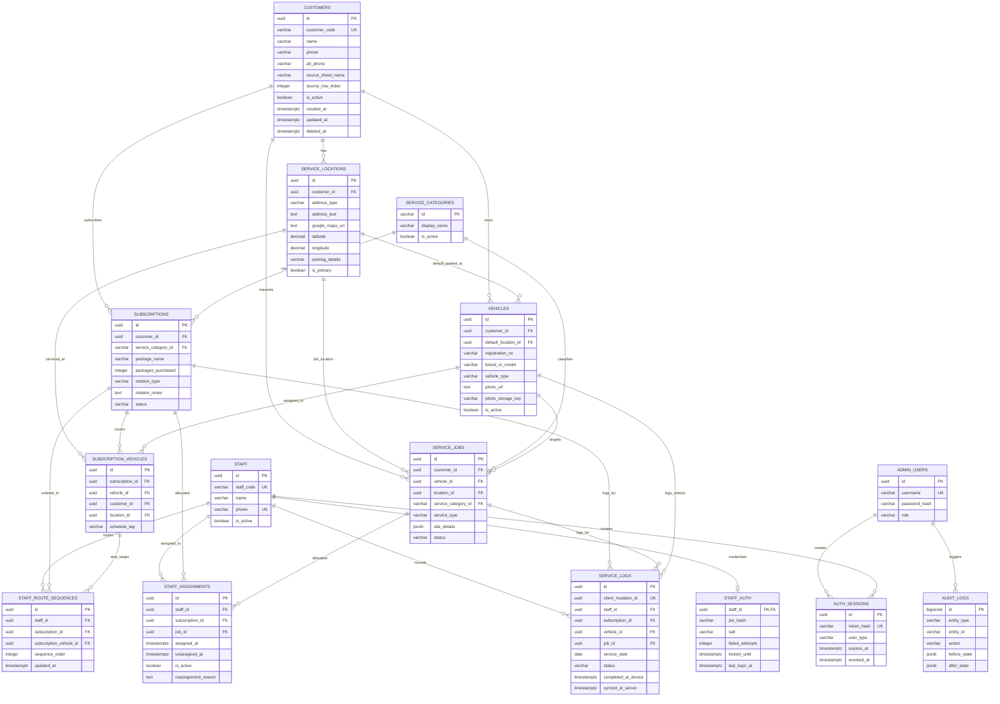

# CWP DATA APP — COMPLETE POSTGRESQL DATABASE ARCHITECTURE DESIGN (v2.1)
**Application Target:** Standalone CWP Customer Data App (`CWPCUSTOMERDATA`)  
**Workspace:** `D:\cwp customer data app`  
**Database Target:** Isolated Neon PostgreSQL (`cwp_customer_db`)  
**Architecture Document Version:** 2.1.0 (Phase 1C.2 Final Corrections Milestone)  
**Status:** PROPOSED & FROZEN FOR REVIEW (Zero DDL/DML Executed — 0 Tables in Neon DB)

---

## 1. Executive Summary & Administrative Decisions Confirmed

This **v2.1 specification** incorporates the final administrative confirmations and mandatory technical corrections required before Phase 1D schema provisioning.

### 1.1. Confirmed Administrative Decisions

1. **Customer Migration Strategy: Option B — Row-Preserving**
   - Every existing row in both Google Sheet tabs (`Daily Clean` and `All Other Work`) will migrate into PostgreSQL as an **independent customer record**.
   - **Duplicate phone numbers are permitted and expected** (e.g. Ritika Jain with Row 4 and Row 5; Aman Jaiswal with Row 21 and Row 22).
   - A unique, stable `customer_code` will be generated for every row (e.g. `CUST_DC_R04_8687333335`, `CUST_DC_R05_8687333335`).
   - Original migration mapping is preserved permanently on every customer record via explicit provenance tracking columns:
     - `source_sheet_name VARCHAR(50) NOT NULL` (`'Daily Clean'` or `'All Other Work'`)
     - `source_row_index INTEGER NOT NULL` (Google Sheet row number, e.g. `4`, `5`, `21`)
   - **Zero automated consolidation:** Customers will not be artificially merged during migration, ensuring 100% parity with existing Google Sheet row references.

2. **Daily Completion Synchronization: Enabled & Hardened**
   - **Zero Latency Staff UI:** Staff continue to check off cards instantly in `Index.html` with optimistic local UI state cached in `localStorage`.
   - **Asynchronous Background Synchronization:** Checkoffs are pushed to the backend `service_logs` table via an offline-resilient sync queue with automatic retry.
   - **Guaranteed Idempotency:** Every client checkoff event is tagged with a client-generated UUID (`client_mutation_id`). Repeated retries across poor mobile connectivity will **never** generate duplicate service logs.
   - **Dual Timestamping:** Captures both the original event time on the staff phone (`completed_at_device`) and the server receipt time (`synced_at_server`).
   - **Visible UI Sync Indicators:** `Index.html` will show clear status indicators:
     - 🟡 *Pending Sync* (stored locally in offline queue)
     - 🟢 *Server Confirmed* (acknowledged by PostgreSQL)
     - 🔴 *Sync Error / Retrying* (network error with exponential backoff)

---

## 2. Mandatory Technical Corrections Addressed in v2.1

### 2.1. Same-Customer Ownership Enforcement (Compound Foreign Keys)
- **Problem:** If Customer A owns Vehicle V and Customer B owns Location L, a naive foreign key setup could allow Vehicle V to be assigned Location L (`default_location_id`). Similarly, a subscription for Customer A could theoretically be overridden with Customer B's parking location.
- **v2.1 Solution:** We enforce cross-table customer ownership directly at the database engine level using **compound unique constraints and compound foreign keys**:
  1. On `service_locations`:
     ```sql
     CONSTRAINT uq_locations_id_customer UNIQUE (id, customer_id)
     ```
  2. On `vehicles`:
     ```sql
     CONSTRAINT fk_vehicles_location_same_customer 
     FOREIGN KEY (default_location_id, customer_id) 
     REFERENCES service_locations(id, customer_id) 
     ON DELETE SET NULL
     ```
  3. On `subscriptions`:
     ```sql
     CONSTRAINT uq_subscriptions_id_customer UNIQUE (id, customer_id)
     ```
  4. On `subscription_vehicles`:
     We include `customer_id UUID NOT NULL` linked via compound FK to `subscriptions(id, customer_id)`:
     ```sql
     CONSTRAINT fk_sub_veh_subscription_customer 
     FOREIGN KEY (subscription_id, customer_id) 
     REFERENCES subscriptions(id, customer_id) 
     ON DELETE CASCADE,
     
     CONSTRAINT fk_sub_veh_location_same_customer 
     FOREIGN KEY (location_id, customer_id) 
     REFERENCES service_locations(id, customer_id) 
     ON DELETE SET NULL
     ```
- **Result:** It is mathematically impossible in PostgreSQL for a vehicle or subscription to reference a service location owned by a different customer.

### 2.2. Precise Semantics: `is_active` vs. `deleted_at`
To eliminate state ambiguity, the lifecycle state machine is strictly defined:

| `is_active` | `deleted_at` | Semantic Meaning | Application Behavior |
|:---:|:---:|---|---|
| `TRUE` | `NULL` | **Operational Active** | Customer is active; subscription is included on staff daily cleaning routes; visible in staff mobile viewer. |
| `FALSE` | `NULL` | **Operational Paused / Inactive** | Customer temporarily paused (e.g. out of town, billing pause, holiday); excluded from staff daily routes; remains fully visible and editable in Admin portal. |
| `FALSE` | `TIMESTAMPTZ` | **Soft-Deleted / Archived** | Customer profile permanently deactivated/archived; hidden from daily operations; retained for historical billing and audit queries. |
| `TRUE` | `TIMESTAMPTZ` | **INVALID STATE** | Prohibited by database engine constraint. |

- **Database-Level Constraint:**
  ```sql
  CONSTRAINT chk_customer_active_deleted_state 
  CHECK (deleted_at IS NULL OR is_active = FALSE)
  ```

### 2.3. Staff Assignment History Protection
- **Problem:** When a route is reassigned from Chandan Soni (`STF01`) to Gaurav Kr Gupta (`STF02`), previous history must not be overwritten, deleted, or mutated.
- **v2.1 Solution:**
  1. **Deletion Prohibited:** Hard deletion of any `staff_assignments` record is prohibited via trigger.
  2. **Immutability of Core Fields:** Once inserted, `staff_id`, `subscription_id`, `job_id`, `assigned_by`, and `assigned_at` cannot be updated. Only `is_active`, `unassigned_at`, `unassigned_by`, and `reassignment_reason` may be modified when deallocating.
  3. **Database Trigger:**
     ```sql
     CREATE OR REPLACE FUNCTION trg_protect_staff_assignments() 
     RETURNS TRIGGER AS $$
     BEGIN
       IF TG_OP = 'DELETE' THEN
         RAISE EXCEPTION 'Security Violation: staff_assignments history is immutable and cannot be deleted.';
       END IF;
       IF TG_OP = 'UPDATE' THEN
         IF NEW.staff_id <> OLD.staff_id OR 
            NEW.subscription_id IS DISTINCT FROM OLD.subscription_id OR 
            NEW.job_id IS DISTINCT FROM OLD.job_id OR 
            NEW.assigned_at <> OLD.assigned_at OR 
            NEW.assigned_by <> OLD.assigned_by THEN
           RAISE EXCEPTION 'Security Violation: Core assignment provenance fields are immutable.';
         END IF;
       END IF;
       RETURN NEW;
     END;
     $$ LANGUAGE plpgsql;

     CREATE TRIGGER trg_staff_assignments_immutability
     BEFORE UPDATE OR DELETE ON staff_assignments
     FOR EACH ROW EXECUTE FUNCTION trg_protect_staff_assignments();
     ```

### 2.4. Independent Route Sequencing for Multi-Vehicle & Multi-Location Subscriptions
- **Problem:** If a customer has 2 vehicles under 1 subscription (e.g. alternate-day rotation: Creta on Day 1, Amaze on Day 2) or multiple service locations (Home morning vs Office afternoon), the staff member needs independent route positions for each stop.
- **v2.1 Solution:** The route sequence entity is refined to reference `subscription_vehicles`:
  - `staff_route_sequences`:
    - `id UUID PRIMARY KEY DEFAULT gen_random_uuid()`
    - `staff_id UUID NOT NULL REFERENCES staff(id) ON DELETE CASCADE`
    - `subscription_id UUID NOT NULL REFERENCES subscriptions(id) ON DELETE CASCADE`
    - `subscription_vehicle_id UUID NULL REFERENCES subscription_vehicles(id) ON DELETE CASCADE`
    - `sequence_order INTEGER NOT NULL`
  - **Unambiguous Constraint:**
    ```sql
    CONSTRAINT uq_staff_route_stop UNIQUE (
      staff_id, 
      subscription_id, 
      COALESCE(subscription_vehicle_id, '00000000-0000-0000-0000-000000000000'::uuid)
    )
    ```
  - If a subscription has multiple vehicles or multiple parking locations, each vehicle stop (`subscription_vehicle_id`) receives an independent ordinal position on the staff member's route.

### 2.5. Service Category Identification: Fixed Slug Primary Keys
- **Confirmation:** The service category identifier is confirmed as a **slug format (`VARCHAR(30) PRIMARY KEY`)**, not an arbitrary UUID.
- **Values:**
  1. `'daily_car_cleaning'` (Daily Car Cleaning)
  2. `'car_washing'` (On-Demand Car Washing)
  3. `'solar_cleaning'` (Rooftop Solar Panel Cleaning)
- **Rationale:**
  - Matches the exact strings used across `Index.html` and `server.js` (`daily_car_cleaning`, `car_washing`, `solar_cleaning`).
  - Eliminates unnecessary multi-table joins for simple category lookups.
  - Foreign keys (`subscriptions.service_category_id`, `service_jobs.service_category_id`) reference `service_categories(id)`.
  - Check constraint on `service_jobs`:
    ```sql
    CONSTRAINT chk_job_category_target CHECK (
      (service_category_id = 'car_washing' AND vehicle_id IS NOT NULL) OR
      (service_category_id = 'solar_cleaning' AND site_details IS NOT NULL) OR
      (service_category_id NOT IN ('car_washing', 'solar_cleaning'))
    )
    ```

### 2.6. India Standard Time (`Asia/Kolkata`) Date Handling & Dual Timestamps
- **Context:** Daily car cleaning takes place in the early morning in India (typically 6:00 AM – 10:00 AM IST). 6:30 AM IST on November 21 is 1:00 AM UTC on November 21. Standardizing on `Asia/Kolkata` prevents UTC date boundary shifts.
- **`service_logs` Specification:**
  - `service_date DATE NOT NULL`: Explicitly computed in IST:
    `service_date = (completed_at_device AT TIME ZONE 'Asia/Kolkata')::date`
  - `completed_at_device TIMESTAMPTZ NOT NULL`: Captured on the staff device when checkoff occurs.
  - `synced_at_server TIMESTAMPTZ NOT NULL DEFAULT CURRENT_TIMESTAMP`: Captured when the record reaches PostgreSQL.
  - `client_mutation_id UUID NOT NULL UNIQUE`: Client-generated idempotency key preventing duplicate logs on network retry.
  - `device_metadata JSONB NULL`: Captures device client version, offline queue duration, and connection mode.

### 2.7. Service Log Idempotency & Completion Rules
- **Business Rule Confirmed:** Under a Daily Car Cleaning subscription, each vehicle is cleaned at most **once per calendar day** (`Asia/Kolkata`).
- **Database Engine Uniqueness Constraints:**
  ```sql
  -- 1. Daily Car Cleaning: exactly one completion per vehicle per subscription per day
  CREATE UNIQUE INDEX uq_service_logs_daily_vehicle 
  ON service_logs (subscription_id, vehicle_id, service_date) 
  WHERE subscription_id IS NOT NULL AND vehicle_id IS NOT NULL;

  -- 2. On-Demand Jobs: exactly one completion per service job
  CREATE UNIQUE INDEX uq_service_logs_job_once 
  ON service_logs (job_id) 
  WHERE job_id IS NOT NULL;

  -- 3. Idempotency across retries: exactly one insertion per client mutation ID
  CREATE UNIQUE INDEX uq_service_logs_client_mutation 
  ON service_logs (client_mutation_id);
  ```

### 2.8. Server-Side Session Expiry and Revocation Enforcement
- **Implementation:**
  - `auth_sessions`:
    - `token_hash VARCHAR(64) UNIQUE NOT NULL` (`SHA-256(token)`).
    - `expires_at TIMESTAMPTZ NOT NULL` (Current time + 12 hours).
    - `revoked_at TIMESTAMPTZ NULL`.
    - `revoked_by VARCHAR(100) NULL`.
  - **SQL Authentication Query Guard:**
    ```sql
    SELECT * FROM auth_sessions 
    WHERE token_hash = encode(sha256($1::bytea), 'hex') 
      AND expires_at > CURRENT_TIMESTAMP 
      AND revoked_at IS NULL;
    ```
  - **Instant Invalidation Events:**
    - Staff PIN reset / Admin password update: `UPDATE auth_sessions SET revoked_at = CURRENT_TIMESTAMP, revoked_by = 'credential_reset' WHERE staff_id = $1 AND revoked_at IS NULL;`
    - Logout: `UPDATE auth_sessions SET revoked_at = CURRENT_TIMESTAMP, revoked_by = 'user_logout' WHERE token_hash = encode(sha256($1::bytea), 'hex');`

---

## 3. Entity Relationship Diagram (v2.1)



---

## 4. Complete 15-Table Schema Specification (v2.1)

### 4.1. `customers`
Master identity of every customer record.
- **Migration Strategy:** Option B — Row-Preserving.
- **Columns:**
  - `id UUID PRIMARY KEY DEFAULT gen_random_uuid()`
  - `customer_code VARCHAR(32) NOT NULL UNIQUE` (e.g. `CUST_DC_R04_8687333335`)
  - `name VARCHAR(150) NOT NULL`
  - `phone VARCHAR(10) NOT NULL` (Normalized 10 digits; non-unique to permit family/multi-row accounts)
  - `alt_phone VARCHAR(15) NULL`
  - `email VARCHAR(150) NULL`
  - `notes TEXT NULL`
  - `source_sheet_name VARCHAR(50) NOT NULL` (`'Daily Clean'` or `'All Other Work'`)
  - `source_row_index INTEGER NOT NULL` (Google Sheet row number)
  - `is_active BOOLEAN NOT NULL DEFAULT TRUE`
  - `created_at TIMESTAMPTZ NOT NULL DEFAULT CURRENT_TIMESTAMP`
  - `updated_at TIMESTAMPTZ NOT NULL DEFAULT CURRENT_TIMESTAMP`
  - `deleted_at TIMESTAMPTZ NULL`
  - `deleted_by VARCHAR(100) NULL`
  - `deletion_reason TEXT NULL`
- **Constraints & Indexes:**
  - `CONSTRAINT chk_customer_active_deleted_state CHECK (deleted_at IS NULL OR is_active = FALSE)`
  - `INDEX idx_customers_phone (phone)`
  - `INDEX idx_customers_active (is_active) WHERE deleted_at IS NULL`
  - `INDEX idx_customers_provenance (source_sheet_name, source_row_index)`

---

### 4.2. `vehicles`
Individual automotive assets owned by customers.
- **Columns:**
  - `id UUID PRIMARY KEY DEFAULT gen_random_uuid()`
  - `customer_id UUID NOT NULL REFERENCES customers(id) ON DELETE RESTRICT`
  - `default_location_id UUID NULL`
  - `registration_no VARCHAR(20) NOT NULL` (Clean uppercase e.g. `UP65FS2830`)
  - `brand_or_model VARCHAR(100) NULL`
  - `vehicle_type VARCHAR(30) NOT NULL DEFAULT 'Car'`
  - `photo_url TEXT NULL`
  - `photo_storage_key VARCHAR(255) NULL`
  - `is_active BOOLEAN NOT NULL DEFAULT TRUE`
  - `created_at TIMESTAMPTZ NOT NULL DEFAULT CURRENT_TIMESTAMP`
  - `updated_at TIMESTAMPTZ NOT NULL DEFAULT CURRENT_TIMESTAMP`
  - `deleted_at TIMESTAMPTZ NULL`
- **Constraints & Indexes:**
  - `CONSTRAINT fk_veh_customer_same_location FOREIGN KEY (default_location_id, customer_id) REFERENCES service_locations(id, customer_id) ON DELETE SET NULL`
  - `INDEX idx_vehicles_customer (customer_id)`
  - `INDEX idx_vehicles_reg (registration_no)`

---

### 4.3. `service_locations`
Physical service addresses and parking coordinates.
- **Columns:**
  - `id UUID PRIMARY KEY DEFAULT gen_random_uuid()`
  - `customer_id UUID NOT NULL REFERENCES customers(id) ON DELETE RESTRICT`
  - `address_type VARCHAR(20) NOT NULL DEFAULT 'primary'`
  - `address_text TEXT NOT NULL`
  - `google_maps_url TEXT NULL`
  - `latitude NUMERIC(10,7) NULL`
  - `longitude NUMERIC(10,7) NULL`
  - `parking_details VARCHAR(255) NULL`
  - `photo_url TEXT NULL`
  - `photo_storage_key VARCHAR(255) NULL`
  - `is_primary BOOLEAN NOT NULL DEFAULT TRUE`
  - `is_active BOOLEAN NOT NULL DEFAULT TRUE`
  - `created_at TIMESTAMPTZ NOT NULL DEFAULT CURRENT_TIMESTAMP`
  - `updated_at TIMESTAMPTZ NOT NULL DEFAULT CURRENT_TIMESTAMP`
  - `deleted_at TIMESTAMPTZ NULL`
- **Constraints & Indexes:**
  - `CONSTRAINT uq_locations_id_customer UNIQUE (id, customer_id)`
  - `INDEX idx_locations_customer (customer_id)`

---

### 4.4. `staff`
Field cleaning personnel master data.
- **Columns:**
  - `id UUID PRIMARY KEY DEFAULT gen_random_uuid()`
  - `staff_code VARCHAR(20) NOT NULL UNIQUE` (e.g. `STF01`, `STF02`)
  - `name VARCHAR(100) NOT NULL`
  - `phone VARCHAR(10) NOT NULL`
  - `is_active BOOLEAN NOT NULL DEFAULT TRUE`
  - `created_at TIMESTAMPTZ NOT NULL DEFAULT CURRENT_TIMESTAMP`
  - `updated_at TIMESTAMPTZ NOT NULL DEFAULT CURRENT_TIMESTAMP`
  - `deleted_at TIMESTAMPTZ NULL`
- **Constraints & Indexes:**
  - `CONSTRAINT uq_staff_phone UNIQUE (phone) WHERE deleted_at IS NULL`
  - `INDEX idx_staff_active (is_active) WHERE deleted_at IS NULL`

---

### 4.5. `staff_auth`
Staff mobile portal credentials with scrypt PIN hashes and lockouts.
- **Columns:**
  - `staff_id UUID PRIMARY KEY REFERENCES staff(id) ON DELETE CASCADE`
  - `pin_hash VARCHAR(255) NOT NULL`
  - `salt VARCHAR(64) NOT NULL`
  - `failed_attempts INTEGER NOT NULL DEFAULT 0`
  - `locked_until TIMESTAMPTZ NULL`
  - `last_login_at TIMESTAMPTZ NULL`
  - `updated_at TIMESTAMPTZ NOT NULL DEFAULT CURRENT_TIMESTAMP`
- **Constraints:**
  - `CONSTRAINT fk_staff_auth_staff FOREIGN KEY (staff_id) REFERENCES staff(id) ON DELETE CASCADE`

---

### 4.6. `service_categories`
Reference master using confirmed fixed slug primary keys.
- **Columns:**
  - `id VARCHAR(30) PRIMARY KEY` (`'daily_car_cleaning'`, `'car_washing'`, `'solar_cleaning'`)
  - `display_name VARCHAR(50) NOT NULL`
  - `description TEXT NULL`
  - `is_active BOOLEAN NOT NULL DEFAULT TRUE`

---

### 4.7. `subscriptions`
Recurring Daily Car Cleaning contracts and alternate-day rotation parameters.
- **Columns:**
  - `id UUID PRIMARY KEY DEFAULT gen_random_uuid()`
  - `customer_id UUID NOT NULL REFERENCES customers(id) ON DELETE RESTRICT`
  - `service_category_id VARCHAR(30) NOT NULL DEFAULT 'daily_car_cleaning' REFERENCES service_categories(id)`
  - `package_name VARCHAR(100) NOT NULL DEFAULT 'Daily Clean'`
  - `packages_purchased INTEGER NOT NULL DEFAULT 1`
  - `rotation_type VARCHAR(30) NOT NULL DEFAULT 'none'`
  - `rotation_notes TEXT NULL`
  - `status VARCHAR(20) NOT NULL DEFAULT 'active'`
  - `start_date DATE NOT NULL DEFAULT CURRENT_DATE`
  - `end_date DATE NULL`
  - `created_at TIMESTAMPTZ NOT NULL DEFAULT CURRENT_TIMESTAMP`
  - `updated_at TIMESTAMPTZ NOT NULL DEFAULT CURRENT_TIMESTAMP`
  - `deleted_at TIMESTAMPTZ NULL`
- **Constraints & Indexes:**
  - `CONSTRAINT uq_subscriptions_id_customer UNIQUE (id, customer_id)`
  - `INDEX idx_sub_customer (customer_id)`
  - `INDEX idx_sub_status (status) WHERE deleted_at IS NULL`

---

### 4.8. `subscription_vehicles`
Junction mapping vehicles to subscriptions with schedule tags and same-customer location overrides.
- **Columns:**
  - `id UUID PRIMARY KEY DEFAULT gen_random_uuid()`
  - `subscription_id UUID NOT NULL`
  - `customer_id UUID NOT NULL`
  - `vehicle_id UUID NOT NULL REFERENCES vehicles(id) ON DELETE RESTRICT`
  - `location_id UUID NULL`
  - `schedule_tag VARCHAR(20) NOT NULL DEFAULT 'daily'`
  - `created_at TIMESTAMPTZ NOT NULL DEFAULT CURRENT_TIMESTAMP`
- **Constraints & Indexes:**
  - `CONSTRAINT fk_sub_veh_sub_cust FOREIGN KEY (subscription_id, customer_id) REFERENCES subscriptions(id, customer_id) ON DELETE CASCADE`
  - `CONSTRAINT fk_sub_veh_loc_cust FOREIGN KEY (location_id, customer_id) REFERENCES service_locations(id, customer_id) ON DELETE SET NULL`
  - `CONSTRAINT uq_sub_vehicle UNIQUE (subscription_id, vehicle_id)`

---

### 4.9. `staff_assignments`
Immutable operational staff assignment ledger.
- **Columns:**
  - `id UUID PRIMARY KEY DEFAULT gen_random_uuid()`
  - `staff_id UUID NOT NULL REFERENCES staff(id) ON DELETE RESTRICT`
  - `subscription_id UUID NULL REFERENCES subscriptions(id) ON DELETE RESTRICT`
  - `job_id UUID NULL REFERENCES service_jobs(id) ON DELETE RESTRICT`
  - `assigned_by VARCHAR(100) NOT NULL DEFAULT 'admin'`
  - `assigned_at TIMESTAMPTZ NOT NULL DEFAULT CURRENT_TIMESTAMP`
  - `unassigned_at TIMESTAMPTZ NULL`
  - `unassigned_by VARCHAR(100) NULL`
  - `is_active BOOLEAN NOT NULL DEFAULT TRUE`
  - `reassignment_reason TEXT NULL`
  - `created_at TIMESTAMPTZ NOT NULL DEFAULT CURRENT_TIMESTAMP`
  - `updated_at TIMESTAMPTZ NOT NULL DEFAULT CURRENT_TIMESTAMP`
- **Constraints & Triggers:**
  - `CONSTRAINT chk_assign_target CHECK ((subscription_id IS NOT NULL AND job_id IS NULL) OR (subscription_id IS NULL AND job_id IS NOT NULL))`
  - `CREATE UNIQUE INDEX uq_active_sub_assignment ON staff_assignments (subscription_id) WHERE is_active = TRUE AND subscription_id IS NOT NULL;`
  - `CREATE UNIQUE INDEX uq_active_job_assignment ON staff_assignments (job_id) WHERE is_active = TRUE AND job_id IS NOT NULL;`
  - `TRIGGER trg_staff_assignments_immutability`: Blocks deletions and core field mutations.

---

### 4.10. `staff_route_sequences`
Ordinal stop positions on staff routes with support for individual vehicle/location stops.
- **Columns:**
  - `id UUID PRIMARY KEY DEFAULT gen_random_uuid()`
  - `staff_id UUID NOT NULL REFERENCES staff(id) ON DELETE CASCADE`
  - `subscription_id UUID NOT NULL REFERENCES subscriptions(id) ON DELETE CASCADE`
  - `subscription_vehicle_id UUID NULL REFERENCES subscription_vehicles(id) ON DELETE CASCADE`
  - `sequence_order INTEGER NOT NULL`
  - `updated_by VARCHAR(100) NOT NULL DEFAULT 'admin'`
  - `updated_at TIMESTAMPTZ NOT NULL DEFAULT CURRENT_TIMESTAMP`
  - `created_at TIMESTAMPTZ NOT NULL DEFAULT CURRENT_TIMESTAMP`
- **Constraints & Indexes:**
  - `CONSTRAINT uq_staff_route_stop UNIQUE (staff_id, subscription_id, COALESCE(subscription_vehicle_id, '00000000-0000-0000-0000-000000000000'::uuid))`
  - `INDEX idx_route_order (staff_id, sequence_order)`

---

### 4.11. `service_jobs`
On-demand Car Washing and Rooftop Solar Cleaning jobs.
- **Columns:**
  - `id UUID PRIMARY KEY DEFAULT gen_random_uuid()`
  - `customer_id UUID NOT NULL REFERENCES customers(id) ON DELETE RESTRICT`
  - `vehicle_id UUID NULL REFERENCES vehicles(id) ON DELETE SET NULL`
  - `location_id UUID NOT NULL REFERENCES service_locations(id) ON DELETE RESTRICT`
  - `service_category_id VARCHAR(30) NOT NULL REFERENCES service_categories(id)`
  - `service_type VARCHAR(100) NOT NULL`
  - `package_details TEXT NULL`
  - `site_details JSONB NULL`
  - `scheduled_date DATE NULL`
  - `status VARCHAR(20) NOT NULL DEFAULT 'assigned'`
  - `special_instructions TEXT NULL`
  - `photo_url TEXT NULL`
  - `photo_storage_key VARCHAR(255) NULL`
  - `created_at TIMESTAMPTZ NOT NULL DEFAULT CURRENT_TIMESTAMP`
  - `updated_at TIMESTAMPTZ NOT NULL DEFAULT CURRENT_TIMESTAMP`
  - `deleted_at TIMESTAMPTZ NULL`
- **Constraints & Indexes:**
  - `CONSTRAINT chk_job_target CHECK ((service_category_id = 'car_washing' AND vehicle_id IS NOT NULL) OR (service_category_id = 'solar_cleaning' AND site_details IS NOT NULL) OR (service_category_id NOT IN ('car_washing', 'solar_cleaning')))`
  - `INDEX idx_jobs_status (status) WHERE deleted_at IS NULL`

---

### 4.12. `service_logs`
Execution history, offline sync logs, and daily service verifications.
- **Columns:**
  - `id UUID PRIMARY KEY DEFAULT gen_random_uuid()`
  - `client_mutation_id UUID NOT NULL UNIQUE` (Client-generated idempotency key)
  - `staff_id UUID NOT NULL REFERENCES staff(id) ON DELETE RESTRICT`
  - `subscription_id UUID NULL REFERENCES subscriptions(id) ON DELETE SET NULL`
  - `vehicle_id UUID NULL REFERENCES vehicles(id) ON DELETE SET NULL`
  - `job_id UUID NULL REFERENCES service_jobs(id) ON DELETE SET NULL`
  - `service_date DATE NOT NULL` (`(completed_at_device AT TIME ZONE 'Asia/Kolkata')::date`)
  - `status VARCHAR(30) NOT NULL DEFAULT 'completed'`
  - `completed_at_device TIMESTAMPTZ NOT NULL`
  - `synced_at_server TIMESTAMPTZ NOT NULL DEFAULT CURRENT_TIMESTAMP`
  - `notes TEXT NULL`
  - `photo_url TEXT NULL`
  - `source VARCHAR(20) NOT NULL DEFAULT 'staff_portal'`
  - `device_metadata JSONB NULL`
  - `created_at TIMESTAMPTZ NOT NULL DEFAULT CURRENT_TIMESTAMP`
- **Constraints & Indexes:**
  - `CREATE UNIQUE INDEX uq_service_logs_daily_vehicle ON service_logs (subscription_id, vehicle_id, service_date) WHERE subscription_id IS NOT NULL AND vehicle_id IS NOT NULL;`
  - `CREATE UNIQUE INDEX uq_service_logs_job_once ON service_logs (job_id) WHERE job_id IS NOT NULL;`
  - `INDEX idx_logs_date (service_date)`
  - `INDEX idx_logs_staff_date (staff_id, service_date)`

---

### 4.13. `admin_users`
Administrator credentials and role definitions.
- **Columns:**
  - `id UUID PRIMARY KEY DEFAULT gen_random_uuid()`
  - `username VARCHAR(50) NOT NULL UNIQUE`
  - `phone VARCHAR(10) NULL`
  - `password_hash VARCHAR(255) NOT NULL`
  - `role VARCHAR(20) NOT NULL DEFAULT 'superadmin'`
  - `is_active BOOLEAN NOT NULL DEFAULT TRUE`
  - `last_login_at TIMESTAMPTZ NULL`
  - `created_at TIMESTAMPTZ NOT NULL DEFAULT CURRENT_TIMESTAMP`
  - `updated_at TIMESTAMPTZ NOT NULL DEFAULT CURRENT_TIMESTAMP`

---

### 4.14. `auth_sessions`
Server-issued revocable bearer sessions.
- **Columns:**
  - `id UUID PRIMARY KEY DEFAULT gen_random_uuid()`
  - `token_hash VARCHAR(64) NOT NULL UNIQUE` (`SHA-256(token)`)
  - `user_type VARCHAR(20) NOT NULL` (`'admin'` or `'staff'`)
  - `staff_id UUID NULL REFERENCES staff(id) ON DELETE CASCADE`
  - `admin_id UUID NULL REFERENCES admin_users(id) ON DELETE CASCADE`
  - `expires_at TIMESTAMPTZ NOT NULL`
  - `revoked_at TIMESTAMPTZ NULL`
  - `revoked_by VARCHAR(100) NULL`
  - `ip_address VARCHAR(45) NULL`
  - `user_agent TEXT NULL`
  - `created_at TIMESTAMPTZ NOT NULL DEFAULT CURRENT_TIMESTAMP`
- **Constraints & Indexes:**
  - `INDEX idx_session_valid (token_hash) WHERE revoked_at IS NULL`
  - `INDEX idx_session_expiry (expires_at)`

---

### 4.15. `audit_logs`
Immutable, trigger-protected operational audit trail.
- **Columns:**
  - `id BIGSERIAL PRIMARY KEY`
  - `entity_type VARCHAR(50) NOT NULL`
  - `entity_id VARCHAR(100) NOT NULL`
  - `action VARCHAR(20) NOT NULL`
  - `changed_by VARCHAR(100) NOT NULL`
  - `before_state JSONB NULL`
  - `after_state JSONB NULL`
  - `ip_address VARCHAR(45) NULL`
  - `created_at TIMESTAMPTZ NOT NULL DEFAULT CURRENT_TIMESTAMP`
- **Triggers:**
  - `TRIGGER prevent_audit_logs_mutation`: Strictly prohibits `UPDATE` or `DELETE` on any audit record.

---

## 5. Offline Background Synchronization Flow

```
[Field Staff Mobile Device (Index.html)]
  │
  ├── 1. Staff taps card: "Mark Cleaned"
  │     ├── Instantly update UI (Card greens, progress bar increments)
  │     ├── Generate client_mutation_id = crypto.randomUUID()
  │     ├── Save state in localStorage (cwp_daily_clean_done)
  │     └── Append event to localStorage syncQueue:
  │           {
  │             client_mutation_id: "e4b2...",
  │             staff_id: "STF01",
  │             subscription_id: "...",
  │             vehicle_id: "...",
  │             completed_at_device: "2026-11-21T07:15:22+05:30",
  │             status: "completed"
  │           }
  │
  ├── 2. Background Sync Engine (Runs every 15s or on navigator.onLine)
  │     ├── Dequeue events in batches
  │     ├── HTTP POST /api { action: "syncServiceLogs", logs: [ ... ] }
  │     │
  │     └── [Node.js Backend (server.js)]
  │           ├── Verify staff session token
  │           ├── Validate staff authorization for each target subscription
  │           │
  │           └── [PostgreSQL (cwp_customer_db)]
  │                 ├── INSERT INTO service_logs (...)
  │                 │   ON CONFLICT (client_mutation_id) DO NOTHING
  │                 └── ON CONFLICT (subscription_id, vehicle_id, service_date) DO NOTHING
  │
  └── 3. Acknowledgment & UI Update
        ├── Backend returns: { success: true, acknowledgedIds: ["e4b2..."] }
        ├── Client removes acknowledged items from syncQueue
        └── UI badge updates from 🟡 "Pending Sync" to 🟢 "Confirmed"
```

---

## 6. Migration Mapping (Option B — Row-Preserving)

Every row from Google Sheets migrates to a distinct set of relational records:

| Source Sheet | Source Row | Generated `customer_code` | Customer Name | Phone (Non-Unique) | Vehicle Reg | Staff Assigned |
|---|---|---|---|---|---|---|
| `Daily Clean` | Row 2 | `CUST_DC_R02_9876543210` | Test Unassigned Cust | `9876543210` | `UP65 AB 9999` | None |
| `Daily Clean` | Row 4 | `CUST_DC_R04_8687333335` | रितिका जैन | `8687333335` | `UP65BY9985` | Chandan Soni |
| `Daily Clean` | Row 5 | `CUST_DC_R05_8687333335` | रितिका जैन | `8687333335` | `UP65DD0909` | Chandan Soni |
| `Daily Clean` | Row 21| `CUST_DC_R21_8299029887` | अमन जायसवाल | `8299029887` | `UP65FH7698` | Chandan Soni |
| `Daily Clean` | Row 22| `CUST_DC_R22_8299029887` | अमन जायसवाल | `8299029887` | `UP65EW4004` | Chandan Soni |
| `Daily Clean` | Row 26| `CUST_DC_R26_8400099996` | विवेक खन्ना | `8400099996` | `FD0220` (XUV B2)| Gaurav Kr Gupta|
| `Daily Clean` | Row 27| `CUST_DC_R27_8400099996` | विवेक खन्ना | `8400099996` | `7501` (Elevate B1)| Gaurav Kr Gupta|

- **Total Rows Migrated:** Exactly 51 rows &rarr; 51 `customers` records, 51 `subscriptions` records, 53+ `vehicles` records.
- **Parity Verification:** Sourced directly from `source_sheet_name` and `source_row_index` for 100% auditability.

---

## 7. Status & Next Step

- **Document Location:** `docs/architecture/CWP_DATA_APP_DATABASE_ARCHITECTURE_v2.1.md`
- **Neon Database (`cwp_customer_db`):** Verified empty (**0 tables, 0 records**).
- **Application (`http://localhost:3000`):** Running and operational on Google Sheets.
- **Monorepo (`D:\cwpdetailersapp`):** Untouched and isolated.

**STOPPED.** Awaiting your explicit administrative approval before initiating Phase 1D schema provisioning.
