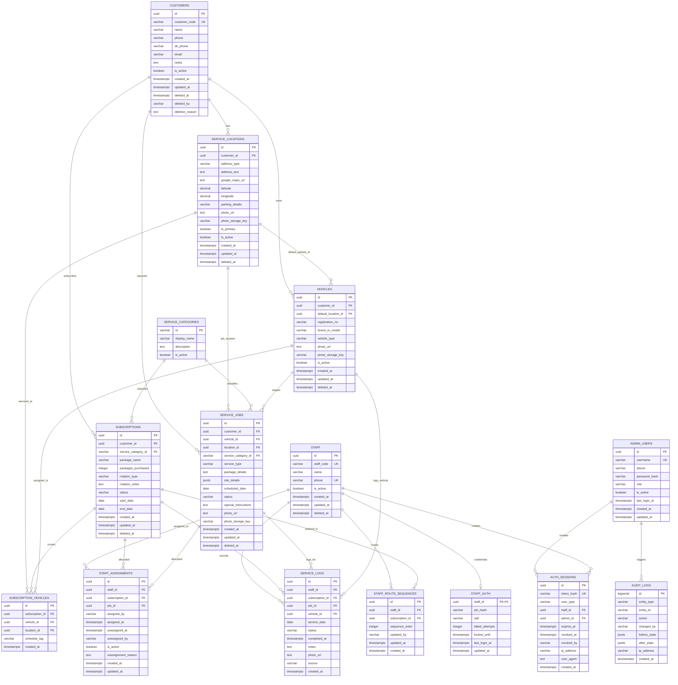

# CWP DATA APP — COMPLETE POSTGRESQL DATABASE ARCHITECTURE DESIGN (v2)
**Application Target:** Standalone CWP Customer Data App (`CWPCUSTOMERDATA`)  
**Workspace:** `D:\cwp customer data app`  
**Database Target:** Isolated Neon PostgreSQL (`cwp_customer_db`)  
**Architecture Document Version:** 2.0.0 (Phase 1C.1 Review Milestone)  
**Status:** PROPOSED & FROZEN FOR REVIEW (Zero DDL/DML Executed — 0 Tables in Neon DB)

---

## 1. Executive Summary & Key Revisions in v2

Following the Phase 1C architecture submission, this **v2 specification** validates and refines the database schema against actual application runtime code (`server.js`, `Index.html`, `Code.gs`) and the 51 active Google Sheets records.

### Summary of Architectural Upgrades in v2:

| Area | v1 Baseline | v2 Revised Design | Forensic Business Justification |
|---|---|---|---|
| **Customer Phone Uniqueness** | `UNIQUE (phone)` | Non-unique `phone` (Indexed) + `customer_code UNIQUE` | **Forensic discovery:** 5 real customer households share phone numbers for multiple vehicles (e.g. Ritika Jain with 2 cars on separate rows, Aman Jaiswal, Dr. Amber). A global unique phone constraint would break data migration. |
| **Vehicle-to-Location Link** | Vehicles had no location link | Added `default_location_id` to `vehicles` & `location_id` to `subscription_vehicles` | Customers with multiple cars park in different locations (e.g. Vivek Khanna: XUV in Basement B2, Elevate in Basement B1). Staff dispatch must show the exact parking location per car. |
| **Staff Reassignment History** | Overwrite existing assignment | Temporal assignment ledger (`assigned_at`, `unassigned_at`, `reassignment_reason`, `is_active`) | Google Sheets overwrites previous staff when Column I changes. v2 guarantees 100% auditable history of which staff member cleaned each car on any date. |
| **Daily Completion Semantics** | Unspecified bridge | Hybrid: Client-side `localStorage` cache + Permanent `service_logs` table | `Index.html` currently stores card checkoffs client-side in `localStorage` without hitting the backend. v2 provides permanent database logging while maintaining offline/fast UI capabilities. |
| **Photo Lifecycle Management** | Only stored URLs | Stored `photo_url` (HTTPS) + `photo_storage_key` (Cloudinary public ID) | Enables automated cleanup and replacement in Cloudinary when customers update vehicle photos, preventing orphaned image accumulation. |
| **Non-Subscription `service_jobs`**| Nullable vehicle and site fields | Strict CHECK constraint: `car_washing` requires `vehicle_id`; `solar_cleaning` requires `site_details` JSONB | Eliminates ambiguous nullable soup and enforces database-level integrity between vehicle wash and solar rooftop jobs. |
| **Audit Log Protection** | Standard table | Immutable trigger-protected append-only table | Prohibits `UPDATE` or `DELETE` on `audit_logs` at the PostgreSQL engine level, guaranteeing tamper-proof operational compliance. |

---

## 2. In-Depth Validation of the Six Core Review Areas

### 2.1. Customer Soft Deletion and Historical Record Preservation
- **Application Context:** `Index.html` and `server.js` implement `toggleCustomerActive` (`Yes` <-> `No`). Records are never permanently deleted from Google Sheets; inactive records are simply hidden from field staff dispatch queues while remaining visible in the admin portal.
- **Relational Implementation:**
  - `customers` features two distinct lifecycle controls:
    1. `is_active BOOLEAN NOT NULL DEFAULT TRUE`: Represents operational active/paused state. When `FALSE`, the customer is excluded from staff daily routes.
    2. `deleted_at TIMESTAMPTZ NULL`, `deleted_by VARCHAR(100) NULL`, `deletion_reason TEXT NULL`: Represents permanent administrative soft-deletion/archival.
  - **Engine-Level Restrict Policy:** All foreign keys referencing `customers(id)` (`vehicles`, `service_locations`, `subscriptions`, `service_jobs`, `service_logs`) use `ON DELETE RESTRICT`. Accidental hard deletion of a customer with historical records is physically blocked by PostgreSQL.
  - **Historical Query Integrity:** Past `service_logs`, `audit_logs`, and billing history remain queryable indefinitely even if a customer profile is deactivated.

### 2.2. Vehicle-to-Location Relationship Flexibility
- **Application Context:** In the live Google Sheet, customers like Vivek Khanna have multiple cars with explicit location notes: `Xuv - FD0220 ( Black ) B2` and `Elevate - 7501 ( White ) B1`. One customer can have different vehicles parked at different locations (home basement, office, secondary tower).
- **Relational Implementation:**
  - `vehicles` has `default_location_id UUID NULL REFERENCES service_locations(id) ON DELETE SET NULL`.
  - `subscription_vehicles` has `location_id UUID NULL REFERENCES service_locations(id) ON DELETE SET NULL`.
  - **Dispatch Resolution Hierarchy:** When the dispatch API generates staff routes:
    1. If `subscription_vehicles.location_id` is set, use that specific parking location.
    2. Else if `vehicles.default_location_id` is set, use that location.
    3. Else fallback to the customer's primary `service_locations` record (`is_primary = TRUE`).
  - This allows a customer to have their SUV cleaned at Home (Tower A, B2) and their sedan cleaned at Office or Secondary Parking without any schema ambiguity.

### 2.3. Staff Reassignment and Historical Assignment Preservation
- **Application Context:** In Google Sheets, assigning a customer to a new staff member (e.g. from Chandan Soni to Gaurav Kr Gupta) overwrites Column I, destroying all record of prior operational responsibility.
- **Relational Implementation:**
  - `staff_assignments` is structured as an immutable assignment ledger:
    - `id UUID PRIMARY KEY DEFAULT gen_random_uuid()`
    - `staff_id UUID NOT NULL REFERENCES staff(id) ON DELETE RESTRICT`
    - `subscription_id UUID NULL REFERENCES subscriptions(id) ON DELETE RESTRICT`
    - `job_id UUID NULL REFERENCES service_jobs(id) ON DELETE RESTRICT`
    - `assigned_by VARCHAR(100) NOT NULL`
    - `assigned_at TIMESTAMPTZ NOT NULL DEFAULT CURRENT_TIMESTAMP`
    - `unassigned_at TIMESTAMPTZ NULL`
    - `unassigned_by VARCHAR(100) NULL`
    - `is_active BOOLEAN NOT NULL DEFAULT TRUE`
    - `reassignment_reason TEXT NULL`
  - **Partial Unique Constraints (Preventing Double-Assignment):**
    ```sql
    CREATE UNIQUE INDEX uq_active_subscription_staff 
    ON staff_assignments (subscription_id) 
    WHERE is_active = TRUE AND subscription_id IS NOT NULL;

    CREATE UNIQUE INDEX uq_active_job_staff 
    ON staff_assignments (job_id) 
    WHERE is_active = TRUE AND job_id IS NOT NULL;
    ```
  - **Reassignment Workflow:** Executed in a single atomic transaction:
    1. Deactivate existing active assignment: `UPDATE staff_assignments SET is_active = FALSE, unassigned_at = CURRENT_TIMESTAMP, unassigned_by = 'admin', reassignment_reason = 'Reassigned to STF02' WHERE subscription_id = ... AND is_active = TRUE;`
    2. Insert new assignment: `INSERT INTO staff_assignments (staff_id, subscription_id, assigned_by) VALUES (...);`
  - History is permanently preserved and auditable for disputes or payroll calculations.

### 2.4. Daily Completion Semantics: Temporary Device-Only Marking vs. Permanent Service Logs
- **Forensic Discovery:** Inspection of `Index.html` (lines 10710–10820) revealed that staff card checkoffs are currently stored **client-side only in browser `localStorage`** (`cwp_daily_clean_done` and `cwp_clean_done_<date>_<staffId>`). The client toggles cards locally so field staff can operate rapidly even with intermittent basement cell connectivity, but the server receives no record of daily completions.
- **Relational Implementation:**
  - We introduce a dedicated `service_logs` table:
    - `id UUID PRIMARY KEY DEFAULT gen_random_uuid()`
    - `staff_id UUID NOT NULL REFERENCES staff(id)`
    - `subscription_id UUID NULL REFERENCES subscriptions(id)`
    - `vehicle_id UUID NULL REFERENCES vehicles(id)`
    - `job_id UUID NULL REFERENCES service_jobs(id)`
    - `service_date DATE NOT NULL DEFAULT CURRENT_DATE`
    - `status VARCHAR(30) NOT NULL` (`'completed'`, `'missed'`, `'rain_delay'`, `'customer_unavailable'`, `'keys_not_available'`)
    - `completed_at TIMESTAMPTZ NOT NULL DEFAULT CURRENT_TIMESTAMP`
    - `notes TEXT NULL`
    - `photo_url TEXT NULL`
    - `source VARCHAR(20) NOT NULL DEFAULT 'staff_portal'` (`'staff_portal'`, `'admin_manual'`, `'offline_sync'`)
  - **Idempotency Constraint:**
    ```sql
    CREATE UNIQUE INDEX uq_service_logs_daily_completion 
    ON service_logs (subscription_id, vehicle_id, service_date) 
    WHERE subscription_id IS NOT NULL;
    ```
  - **Hybrid Operational Bridge:**
    1. Field staff continue to experience instant, optimistic UI feedback via `localStorage`.
    2. When a card is marked complete, `Index.html` asynchronously posts `action: 'logDailyClean'` to `server.js`.
    3. If offline, completions are queued in `localStorage` and flushed when back online.
    4. Administrators gain real-time visibility into route progress, missed cleans, and historical completion statistics.

### 2.5. Cloudinary Reference Photo Storage
- **Application Context:** `server.js` receives base64 encoded photos (`photoFile`/`photoData`) and uploads them to Cloudinary CDN folder `cwp_customer_photos`, storing the returned HTTPS `secure_url`.
- **Relational Implementation:**
  - **Zero Binary Blobs in PostgreSQL:** PostgreSQL stores only lightweight text metadata:
    - `photo_url TEXT NULL`: Direct HTTPS CDN link for display in staff lightboxes and admin cards.
    - `photo_storage_key VARCHAR(255) NULL`: Cloudinary `public_id` (e.g. `cwp_customer_photos/cwp_17321048293`).
  - **Storage Locations:** Added to `vehicles`, `service_jobs`, `service_locations`, and `service_logs`.
  - **Lifecycle Management:** When an admin uploads a replacement photo, `server.js` uses `photo_storage_key` to call `cloudinary.uploader.destroy()`, deleting the old image and preventing orphaned file accumulation.

### 2.6. Customer Phone Uniqueness and Family/Shared-Number Cases
- **Forensic Discovery:** Querying the live Google Sheet revealed **6 duplicate phone instances** (5 active customer households):
  1. `8687333335`: Customer `रितिका जैन` (Row 4: `UP65BY9985`; Row 5: `UP65DD0909`).
  2. `8299029887`: Customer `अमन जायसवाल` (Row 21: `UP65FH7698`; Row 22: `UP65EW4004`).
  3. `9838204066`: Customer `वैभव श्रीवास्तव` (Row 23: `UP65FR9699`; Row 24: `UP65CW0878`).
  4. `8400099996`: Customer `विवेक खन्ना` (Row 26: `Xuv - FD0220`; Row 27: `Elevate - 7501`).
  5. `7607552265`: Customer `डॉ. अंबर` (Row 36: `UP65FJ3252`; Row 37: `UP65EQ0725`).
- **Relational Decision:**
  - A strict global `UNIQUE (phone)` constraint on `customers` is **factually incompatible** with the business model. In Indian residential communities, multiple family members or separate vehicle entries routinely share a primary mobile number.
  - **Solution in v2:**
    - `phone VARCHAR(10) NOT NULL` is indexed for instant search (`INDEX idx_customers_phone (phone)`), but **not uniquely constrained**.
    - Primary business uniqueness is enforced on `customer_code VARCHAR(32) UNIQUE NOT NULL` (e.g. `CUST_8687333335_01`, `CUST_8687333335_02`).
    - During migration, multi-car rows for the same customer can either be consolidated into one customer with multiple vehicles or migrated as distinct profiles sharing a phone number without constraint violations.

---

## 3. Additional Architectural Verifications

### 3.1. `service_jobs`: Car Washing vs. Solar Cleaning Segregation
To prevent ambiguous nullable fields between automotive washing and rooftop solar panel cleaning, `service_jobs` uses a polymorphic discriminator with explicit check constraints:
- `service_category_id VARCHAR(30) NOT NULL REFERENCES service_categories(id)` (`'car_washing'` or `'solar_cleaning'`).
- `vehicle_id UUID NULL REFERENCES vehicles(id)`: Mandatory for `car_washing`.
- `site_details JSONB NULL`: Mandatory for `solar_cleaning` (stores structured solar properties: `{"site_name": "Rooftop 5kW", "panel_count": 16, "capacity_kw": 5.4, "inverter_brand": "Luminous"}`).
- **Engine-Level Validation Constraint:**
  ```sql
  CONSTRAINT chk_job_category_target CHECK (
    (service_category_id = 'car_washing' AND vehicle_id IS NOT NULL) OR
    (service_category_id = 'solar_cleaning' AND site_details IS NOT NULL) OR
    (service_category_id NOT IN ('car_washing', 'solar_cleaning'))
  )
  ```

### 3.2. Role and Credential Isolation: `staff_auth` vs. `admin_users`
- Field staff and administrators have zero credential overlap:
  - **`staff_auth`**: Associated 1:1 with `staff(id)`. Uses 6-digit numeric PINs hashed with `scrypt` and individual 16-byte cryptographic salts. Tracks failed attempts (lockout after 5 failures). Staff accounts cannot access admin routes or administrative dashboards.
  - **`admin_users`**: Standalone administrative accounts (`username`, `password_hash`, `role`). Uses complex passwords hashed with `scrypt`. Roles: `'superadmin'`, `'admin'`, `'viewer'`. Admins cannot be assigned field cleaning routes.

### 3.3. `auth_sessions`: Hashing, Expiration & Revocation
- Plaintext session tokens are **never stored** in the database.
- When a user logs in, the server generates a 32-byte cryptographically secure random token (`crypto.randomBytes(32).toString('hex')`) and returns it to the client.
- The database stores only `token_hash VARCHAR(64) UNIQUE NOT NULL` (`SHA-256(token)`).
- **Session Attributes:**
  - `expires_at TIMESTAMPTZ NOT NULL` (Default 12 hours).
  - `revoked_at TIMESTAMPTZ NULL` (Set immediately upon logout or credential reset).
  - `revoked_by VARCHAR(100) NULL`.
- **Validation Query:**
  ```sql
  SELECT * FROM auth_sessions 
  WHERE token_hash = encode(sha256($1::bytea), 'hex') 
    AND expires_at > CURRENT_TIMESTAMP 
    AND revoked_at IS NULL;
  ```
- **Session Revocation:** Resetting a staff member's PIN or updating an admin password immediately revokes all active sessions for that user ID:
  ```sql
  UPDATE auth_sessions SET revoked_at = CURRENT_TIMESTAMP, revoked_by = 'security_reset' 
  WHERE staff_id = $1 AND revoked_at IS NULL;
  ```

### 3.4. `audit_logs`: Engine-Level Immutability Protection
To prevent tampering or deletion of operational history (even by administrative users), `audit_logs` is protected by a PostgreSQL database trigger:
```sql
CREATE OR REPLACE FUNCTION trg_protect_audit_logs() 
RETURNS TRIGGER AS $$
BEGIN
  RAISE EXCEPTION 'Security Violation: audit_logs entries are immutable and cannot be updated or deleted.';
END;
$$ LANGUAGE plpgsql;

CREATE TRIGGER prevent_audit_logs_mutation
BEFORE UPDATE OR DELETE ON audit_logs
FOR EACH ROW EXECUTE FUNCTION trg_protect_audit_logs();
```

### 3.5. `staff_route_sequences`: Multi-Vehicle & Multi-Location Route Integrity
- If route sequences were keyed only to `customer_id`, a customer with two separate daily cleaning cars or two distinct service locations would cause key collisions or sequence ambiguity.
- **v2 Solution:** `staff_route_sequences` is keyed strictly to `(staff_id, subscription_id)`:
  - Each `subscriptions` record represents an individual service commitment.
  - If a customer has two daily cars on separate subscriptions or locations, each has its own independent stop number on the staff member's route.
  - `CONSTRAINT uq_staff_subscription_sequence UNIQUE (staff_id, subscription_id)` guarantees unambiguous, collision-free dispatch order.

---

## 4. Revised Entity Relationship Diagram (v2)



---

## 5. Complete Table-by-Table Column Specifications (v2)

### 5.1. `customers`
| Column | Type | Nullable | Default | Description |
|---|---|---|---|---|
| `id` | `UUID` | NO | `gen_random_uuid()` | Primary Key |
| `customer_code` | `VARCHAR(32)` | NO | — | Unique Human ID (e.g. `CUST_8687333335_01`) |
| `name` | `VARCHAR(150)` | NO | — | Customer full name |
| `phone` | `VARCHAR(10)` | NO | — | Normalized 10-digit mobile (Indexed, non-unique) |
| `alt_phone` | `VARCHAR(15)` | YES | `NULL` | Secondary phone |
| `email` | `VARCHAR(150)` | YES | `NULL` | Optional email |
| `notes` | `TEXT` | YES | `NULL` | General notes |
| `is_active` | `BOOLEAN` | NO | `TRUE` | Operational active toggle |
| `created_at` | `TIMESTAMPTZ` | NO | `CURRENT_TIMESTAMP`| Creation timestamp |
| `updated_at` | `TIMESTAMPTZ` | NO | `CURRENT_TIMESTAMP`| Last update timestamp |
| `deleted_at` | `TIMESTAMPTZ` | YES | `NULL` | Soft deletion timestamp |
| `deleted_by` | `VARCHAR(100)`| YES | `NULL` | Admin who deleted profile |
| `deletion_reason`| `TEXT` | YES | `NULL` | Deletion reason / note |

**Keys & Indexes:**
- `CONSTRAINT pk_customers PRIMARY KEY (id)`
- `CONSTRAINT uq_customers_code UNIQUE (customer_code)`
- `INDEX idx_customers_phone (phone)`
- `INDEX idx_customers_active (is_active) WHERE deleted_at IS NULL`

---

### 5.2. `vehicles`
| Column | Type | Nullable | Default | Description |
|---|---|---|---|---|
| `id` | `UUID` | NO | `gen_random_uuid()` | Primary Key |
| `customer_id` | `UUID` | NO | — | FK to `customers(id)` ON DELETE RESTRICT |
| `default_location_id`| `UUID` | YES | `NULL` | FK to `service_locations(id)` ON DELETE SET NULL |
| `registration_no`| `VARCHAR(20)` | NO | — | Normalized license plate (e.g. `UP65FS2830`) |
| `brand_or_model` | `VARCHAR(100)` | YES | `NULL` | Make / Model (e.g. `Creta`, `Amaze`) |
| `vehicle_type` | `VARCHAR(30)` | NO | `'Car'` | Type: `Car`, `SUV`, `Hatchback`, `Sedan`, `Site` |
| `photo_url` | `TEXT` | YES | `NULL` | Cloudinary HTTPS URL |
| `photo_storage_key`| `VARCHAR(255)`| YES | `NULL` | Cloudinary `public_id` |
| `is_active` | `BOOLEAN` | NO | `TRUE` | Active status |
| `created_at` | `TIMESTAMPTZ` | NO | `CURRENT_TIMESTAMP`| Creation timestamp |
| `updated_at` | `TIMESTAMPTZ` | NO | `CURRENT_TIMESTAMP`| Update timestamp |
| `deleted_at` | `TIMESTAMPTZ` | YES | `NULL` | Soft delete timestamp |

**Keys & Indexes:**
- `CONSTRAINT pk_vehicles PRIMARY KEY (id)`
- `CONSTRAINT fk_veh_customer FOREIGN KEY (customer_id) REFERENCES customers(id) ON DELETE RESTRICT`
- `CONSTRAINT fk_veh_location FOREIGN KEY (default_location_id) REFERENCES service_locations(id) ON DELETE SET NULL`
- `INDEX idx_vehicles_customer (customer_id)`
- `INDEX idx_vehicles_reg (registration_no)`

---

### 5.3. `service_locations`
| Column | Type | Nullable | Default | Description |
|---|---|---|---|---|
| `id` | `UUID` | NO | `gen_random_uuid()` | Primary Key |
| `customer_id` | `UUID` | NO | — | FK to `customers(id)` ON DELETE RESTRICT |
| `address_type` | `VARCHAR(20)` | NO | `'primary'` | `'primary'`, `'secondary'`, `'basement_b1'`, `'office'` |
| `address_text` | `TEXT` | NO | — | Society, flat, tower, landmark |
| `google_maps_url`| `TEXT` | YES | `NULL` | Navigation link |
| `latitude` | `NUMERIC(10,7)`| YES | `NULL` | GPS Latitude |
| `longitude`| `NUMERIC(10,7)`| YES | `NULL` | GPS Longitude |
| `parking_details`| `VARCHAR(255)`| YES | `NULL` | Pillar number / basement zone |
| `photo_url` | `TEXT` | YES | `NULL` | Parking location photo URL |
| `photo_storage_key`| `VARCHAR(255)`| YES | `NULL` | Cloudinary `public_id` |
| `is_primary` | `BOOLEAN` | NO | `TRUE` | Primary dispatch flag |
| `is_active` | `BOOLEAN` | NO | `TRUE` | Active flag |
| `created_at` | `TIMESTAMPTZ` | NO | `CURRENT_TIMESTAMP`| Creation timestamp |
| `updated_at` | `TIMESTAMPTZ` | NO | `CURRENT_TIMESTAMP`| Update timestamp |
| `deleted_at` | `TIMESTAMPTZ` | YES | `NULL` | Soft delete timestamp |

**Keys & Indexes:**
- `CONSTRAINT pk_service_locations PRIMARY KEY (id)`
- `CONSTRAINT fk_loc_customer FOREIGN KEY (customer_id) REFERENCES customers(id) ON DELETE RESTRICT`
- `INDEX idx_locations_customer (customer_id)`

---

### 5.4. `staff`
| Column | Type | Nullable | Default | Description |
|---|---|---|---|---|
| `id` | `UUID` | NO | `gen_random_uuid()` | Primary Key |
| `staff_code` | `VARCHAR(20)` | NO | — | Unique Staff Code (`STF01`, `STF02`) |
| `name` | `VARCHAR(100)` | NO | — | Full name |
| `phone` | `VARCHAR(10)` | NO | — | 10-digit mobile |
| `is_active` | `BOOLEAN` | NO | `TRUE` | Active flag |
| `created_at` | `TIMESTAMPTZ` | NO | `CURRENT_TIMESTAMP`| Creation timestamp |
| `updated_at` | `TIMESTAMPTZ` | NO | `CURRENT_TIMESTAMP`| Update timestamp |
| `deleted_at` | `TIMESTAMPTZ` | YES | `NULL` | Soft delete timestamp |

**Keys & Indexes:**
- `CONSTRAINT pk_staff PRIMARY KEY (id)`
- `CONSTRAINT uq_staff_code UNIQUE (staff_code)`
- `CONSTRAINT uq_staff_phone UNIQUE (phone) WHERE deleted_at IS NULL`
- `INDEX idx_staff_active (is_active) WHERE deleted_at IS NULL`

---

### 5.5. `staff_auth`
| Column | Type | Nullable | Default | Description |
|---|---|---|---|---|
| `staff_id` | `UUID` | NO | — | PK & FK to `staff(id)` ON DELETE CASCADE |
| `pin_hash` | `VARCHAR(255)`| NO | — | `scrypt` hash of 6-digit PIN |
| `salt` | `VARCHAR(64)` | NO | — | 16-byte random salt |
| `failed_attempts`| `INTEGER` | NO | `0` | Consecutive failed attempts |
| `locked_until` | `TIMESTAMPTZ` | YES | `NULL` | Lockout expiration |
| `last_login_at`| `TIMESTAMPTZ` | YES | `NULL` | Last login timestamp |
| `updated_at` | `TIMESTAMPTZ` | NO | `CURRENT_TIMESTAMP`| Credential update timestamp |

**Keys & Indexes:**
- `CONSTRAINT pk_staff_auth PRIMARY KEY (staff_id)`
- `CONSTRAINT fk_staff_auth_staff FOREIGN KEY (staff_id) REFERENCES staff(id) ON DELETE CASCADE`

---

### 5.6. `service_categories`
| Column | Type | Nullable | Default | Description |
|---|---|---|---|---|
| `id` | `VARCHAR(30)` | NO | — | PK (`daily_car_cleaning`, `car_washing`, `solar_cleaning`) |
| `display_name` | `VARCHAR(50)` | NO | — | Human name (`Daily Car Cleaning`) |
| `description` | `TEXT` | YES | `NULL` | Description |
| `is_active` | `BOOLEAN` | NO | `TRUE` | Active status |

---

### 5.7. `subscriptions`
| Column | Type | Nullable | Default | Description |
|---|---|---|---|---|
| `id` | `UUID` | NO | `gen_random_uuid()` | Primary Key |
| `customer_id` | `UUID` | NO | — | FK to `customers(id)` ON DELETE RESTRICT |
| `service_category_id`| `VARCHAR(30)`| NO | `'daily_car_cleaning'`| FK to `service_categories(id)` |
| `package_name` | `VARCHAR(100)`| NO | `'Daily Clean'` | Package tier |
| `packages_purchased`| `INTEGER` | NO | `1` | Number of packages |
| `rotation_type`| `VARCHAR(30)` | NO | `'none'` | `'none'`, `'alternate_day_aaj_kal'`, `'multi_car'` |
| `rotation_notes`| `TEXT` | YES | `NULL` | Hindi/English rotation rules |
| `status` | `VARCHAR(20)` | NO | `'active'` | `'active'`, `'paused'`, `'cancelled'` |
| `start_date` | `DATE` | NO | `CURRENT_DATE` | Start date |
| `end_date` | `DATE` | YES | `NULL` | End date |
| `created_at` | `TIMESTAMPTZ` | NO | `CURRENT_TIMESTAMP`| Creation timestamp |
| `updated_at` | `TIMESTAMPTZ` | NO | `CURRENT_TIMESTAMP`| Update timestamp |
| `deleted_at` | `TIMESTAMPTZ` | YES | `NULL` | Soft delete timestamp |

**Keys & Indexes:**
- `CONSTRAINT pk_subscriptions PRIMARY KEY (id)`
- `CONSTRAINT fk_sub_customer FOREIGN KEY (customer_id) REFERENCES customers(id) ON DELETE RESTRICT`
- `CONSTRAINT fk_sub_category FOREIGN KEY (service_category_id) REFERENCES service_categories(id)`
- `INDEX idx_sub_customer (customer_id)`
- `INDEX idx_sub_status (status) WHERE deleted_at IS NULL`

---

### 5.8. `subscription_vehicles`
| Column | Type | Nullable | Default | Description |
|---|---|---|---|---|
| `id` | `UUID` | NO | `gen_random_uuid()` | Primary Key |
| `subscription_id`| `UUID` | NO | — | FK to `subscriptions(id)` ON DELETE CASCADE |
| `vehicle_id` | `UUID` | NO | — | FK to `vehicles(id)` ON DELETE RESTRICT |
| `location_id` | `UUID` | YES | `NULL` | FK to `service_locations(id)` ON DELETE SET NULL |
| `schedule_tag` | `VARCHAR(20)` | NO | `'daily'` | `'daily'`, `'aaj'`, `'kal'`, `'alternate'` |
| `created_at` | `TIMESTAMPTZ` | NO | `CURRENT_TIMESTAMP`| Creation timestamp |

**Keys & Indexes:**
- `CONSTRAINT pk_sub_vehicles PRIMARY KEY (id)`
- `CONSTRAINT fk_sub_veh_sub FOREIGN KEY (subscription_id) REFERENCES subscriptions(id) ON DELETE CASCADE`
- `CONSTRAINT fk_sub_veh_veh FOREIGN KEY (vehicle_id) REFERENCES vehicles(id) ON DELETE RESTRICT`
- `CONSTRAINT fk_sub_veh_loc FOREIGN KEY (location_id) REFERENCES service_locations(id) ON DELETE SET NULL`
- `CONSTRAINT uq_sub_vehicle UNIQUE (subscription_id, vehicle_id)`

---

### 5.9. `staff_assignments`
| Column | Type | Nullable | Default | Description |
|---|---|---|---|---|
| `id` | `UUID` | NO | `gen_random_uuid()` | Primary Key |
| `staff_id` | `UUID` | NO | — | FK to `staff(id)` ON DELETE RESTRICT |
| `subscription_id`| `UUID` | YES | `NULL` | FK to `subscriptions(id)` ON DELETE RESTRICT |
| `job_id` | `UUID` | YES | `NULL` | FK to `service_jobs(id)` ON DELETE RESTRICT |
| `assigned_by` | `VARCHAR(100)`| NO | `'admin'` | Assigning user |
| `assigned_at` | `TIMESTAMPTZ` | NO | `CURRENT_TIMESTAMP`| Assignment timestamp |
| `unassigned_at` | `TIMESTAMPTZ` | YES | `NULL` | Deallocation timestamp |
| `unassigned_by` | `VARCHAR(100)`| YES | `NULL` | Deallocating user |
| `is_active` | `BOOLEAN` | NO | `TRUE` | Active assignment flag |
| `reassignment_reason`| `TEXT` | YES | `NULL` | Audit reason |
| `created_at` | `TIMESTAMPTZ` | NO | `CURRENT_TIMESTAMP`| Creation timestamp |
| `updated_at` | `TIMESTAMPTZ` | NO | `CURRENT_TIMESTAMP`| Update timestamp |

**Keys & Indexes:**
- `CONSTRAINT pk_staff_assignments PRIMARY KEY (id)`
- `CONSTRAINT fk_assign_staff FOREIGN KEY (staff_id) REFERENCES staff(id) ON DELETE RESTRICT`
- `CONSTRAINT fk_assign_sub FOREIGN KEY (subscription_id) REFERENCES subscriptions(id) ON DELETE RESTRICT`
- `CONSTRAINT fk_assign_job FOREIGN KEY (job_id) REFERENCES service_jobs(id) ON DELETE RESTRICT`
- `CONSTRAINT chk_assign_target CHECK ((subscription_id IS NOT NULL AND job_id IS NULL) OR (subscription_id IS NULL AND job_id IS NOT NULL))`
- `CREATE UNIQUE INDEX uq_active_sub_assignment ON staff_assignments (subscription_id) WHERE is_active = TRUE AND subscription_id IS NOT NULL;`
- `CREATE UNIQUE INDEX uq_active_job_assignment ON staff_assignments (job_id) WHERE is_active = TRUE AND job_id IS NOT NULL;`
- `INDEX idx_assign_staff_active (staff_id, is_active)`

---

### 5.10. `staff_route_sequences`
| Column | Type | Nullable | Default | Description |
|---|---|---|---|---|
| `id` | `UUID` | NO | `gen_random_uuid()` | Primary Key |
| `staff_id` | `UUID` | NO | — | FK to `staff(id)` ON DELETE CASCADE |
| `subscription_id`| `UUID` | NO | — | FK to `subscriptions(id)` ON DELETE CASCADE |
| `sequence_order` | `INTEGER` | NO | — | Route stop position (1, 2, 3...) |
| `updated_by` | `VARCHAR(100)`| NO | `'admin'` | User who reordered |
| `updated_at` | `TIMESTAMPTZ` | NO | `CURRENT_TIMESTAMP`| Reorder timestamp |
| `created_at` | `TIMESTAMPTZ` | NO | `CURRENT_TIMESTAMP`| Creation timestamp |

**Keys & Indexes:**
- `CONSTRAINT pk_staff_route_sequences PRIMARY KEY (id)`
- `CONSTRAINT fk_seq_staff FOREIGN KEY (staff_id) REFERENCES staff(id) ON DELETE CASCADE`
- `CONSTRAINT fk_seq_sub FOREIGN KEY (subscription_id) REFERENCES subscriptions(id) ON DELETE CASCADE`
- `CONSTRAINT uq_staff_sub_sequence UNIQUE (staff_id, subscription_id)`
- `INDEX idx_route_order (staff_id, sequence_order)`

---

### 5.11. `service_jobs`
| Column | Type | Nullable | Default | Description |
|---|---|---|---|---|
| `id` | `UUID` | NO | `gen_random_uuid()` | Primary Key |
| `customer_id` | `UUID` | NO | — | FK to `customers(id)` ON DELETE RESTRICT |
| `vehicle_id` | `UUID` | YES | `NULL` | FK to `vehicles(id)` ON DELETE SET NULL (Required if car wash) |
| `location_id` | `UUID` | NO | — | FK to `service_locations(id)` ON DELETE RESTRICT |
| `service_category_id`| `VARCHAR(30)`| NO | — | FK to `service_categories(id)` |
| `service_type` | `VARCHAR(100)`| NO | — | Job name (`Deep Wash`, `Solar Clean`) |
| `package_details`| `TEXT` | YES | `NULL` | Work scope |
| `site_details` | `JSONB` | YES | `NULL` | Structured site specs (Required if solar clean) |
| `scheduled_date` | `DATE` | YES | `NULL` | Service date |
| `status` | `VARCHAR(20)` | NO | `'assigned'` | `'pending'`, `'assigned'`, `'completed'`, `'cancelled'` |
| `special_instructions`| `TEXT` | YES | `NULL` | Operational instructions |
| `photo_url` | `TEXT` | YES | `NULL` | Photo URL |
| `photo_storage_key`| `VARCHAR(255)`| YES | `NULL` | Cloudinary `public_id` |
| `created_at` | `TIMESTAMPTZ` | NO | `CURRENT_TIMESTAMP`| Creation timestamp |
| `updated_at` | `TIMESTAMPTZ` | NO | `CURRENT_TIMESTAMP`| Update timestamp |
| `deleted_at` | `TIMESTAMPTZ` | YES | `NULL` | Soft delete timestamp |

**Keys & Indexes:**
- `CONSTRAINT pk_service_jobs PRIMARY KEY (id)`
- `CONSTRAINT fk_jobs_customer FOREIGN KEY (customer_id) REFERENCES customers(id) ON DELETE RESTRICT`
- `CONSTRAINT fk_jobs_veh FOREIGN KEY (vehicle_id) REFERENCES vehicles(id) ON DELETE SET NULL`
- `CONSTRAINT fk_jobs_loc FOREIGN KEY (location_id) REFERENCES service_locations(id) ON DELETE RESTRICT`
- `CONSTRAINT fk_jobs_cat FOREIGN KEY (service_category_id) REFERENCES service_categories(id)`
- `CONSTRAINT chk_job_target CHECK ((service_category_id = 'car_washing' AND vehicle_id IS NOT NULL) OR (service_category_id = 'solar_cleaning' AND site_details IS NOT NULL) OR (service_category_id NOT IN ('car_washing', 'solar_cleaning')))`
- `INDEX idx_jobs_status (status) WHERE deleted_at IS NULL`

---

### 5.12. `service_logs`
| Column | Type | Nullable | Default | Description |
|---|---|---|---|---|
| `id` | `UUID` | NO | `gen_random_uuid()` | Primary Key |
| `staff_id` | `UUID` | NO | — | FK to `staff(id)` ON DELETE RESTRICT |
| `subscription_id`| `UUID` | YES | `NULL` | FK to `subscriptions(id)` ON DELETE SET NULL |
| `job_id` | `UUID` | YES | `NULL` | FK to `service_jobs(id)` ON DELETE SET NULL |
| `vehicle_id` | `UUID` | YES | `NULL` | FK to `vehicles(id)` ON DELETE SET NULL |
| `service_date` | `DATE` | NO | `CURRENT_DATE` | Date service was performed |
| `status` | `VARCHAR(30)` | NO | `'completed'` | `'completed'`, `'missed'`, `'rain_delay'`, `'unavailable'` |
| `completed_at` | `TIMESTAMPTZ` | NO | `CURRENT_TIMESTAMP`| Exact completion timestamp |
| `notes` | `TEXT` | YES | `NULL` | Staff field notes |
| `photo_url` | `TEXT` | YES | `NULL` | Verification photo URL |
| `source` | `VARCHAR(20)` | NO | `'staff_portal'` | `'staff_portal'`, `'admin_manual'`, `'offline_sync'` |
| `created_at` | `TIMESTAMPTZ` | NO | `CURRENT_TIMESTAMP`| Record timestamp |

**Keys & Indexes:**
- `CONSTRAINT pk_service_logs PRIMARY KEY (id)`
- `CONSTRAINT fk_logs_staff FOREIGN KEY (staff_id) REFERENCES staff(id) ON DELETE RESTRICT`
- `CONSTRAINT uq_daily_service_log UNIQUE (subscription_id, vehicle_id, service_date)`
- `INDEX idx_logs_date (service_date)`
- `INDEX idx_logs_staff_date (staff_id, service_date)`

---

### 5.13. `admin_users`
| Column | Type | Nullable | Default | Description |
|---|---|---|---|---|
| `id` | `UUID` | NO | `gen_random_uuid()` | Primary Key |
| `username` | `VARCHAR(50)` | NO | — | Unique login name / phone |
| `phone` | `VARCHAR(10)` | YES | `NULL` | Admin phone |
| `password_hash`| `VARCHAR(255)`| NO | — | `scrypt` hash of password |
| `role` | `VARCHAR(20)` | NO | `'superadmin'` | `'superadmin'`, `'admin'`, `'viewer'` |
| `is_active` | `BOOLEAN` | NO | `TRUE` | Active flag |
| `last_login_at`| `TIMESTAMPTZ` | YES | `NULL` | Last login timestamp |
| `created_at` | `TIMESTAMPTZ` | NO | `CURRENT_TIMESTAMP`| Creation timestamp |
| `updated_at` | `TIMESTAMPTZ` | NO | `CURRENT_TIMESTAMP`| Update timestamp |

**Keys & Indexes:**
- `CONSTRAINT pk_admin_users PRIMARY KEY (id)`
- `CONSTRAINT uq_admin_username UNIQUE (username)`

---

### 5.14. `auth_sessions`
| Column | Type | Nullable | Default | Description |
|---|---|---|---|---|
| `id` | `UUID` | NO | `gen_random_uuid()` | Primary Key |
| `token_hash` | `VARCHAR(64)` | NO | — | `SHA-256` hash of bearer token |
| `user_type` | `VARCHAR(20)` | NO | — | `'admin'` or `'staff'` |
| `staff_id` | `UUID` | YES | `NULL` | FK to `staff(id)` ON DELETE CASCADE |
| `admin_id` | `UUID` | YES | `NULL` | FK to `admin_users(id)` ON DELETE CASCADE |
| `expires_at` | `TIMESTAMPTZ` | NO | — | Expiration timestamp (12h TTL) |
| `revoked_at` | `TIMESTAMPTZ` | YES | `NULL` | Explicit revocation timestamp |
| `revoked_by` | `VARCHAR(100)`| YES | `NULL` | User or mechanism who revoked |
| `ip_address` | `VARCHAR(45)` | YES | `NULL` | Caller IP |
| `user_agent` | `TEXT` | YES | `NULL` | Caller User-Agent |
| `created_at` | `TIMESTAMPTZ` | NO | `CURRENT_TIMESTAMP`| Issuance timestamp |

**Keys & Indexes:**
- `CONSTRAINT pk_auth_sessions PRIMARY KEY (id)`
- `CONSTRAINT uq_session_token UNIQUE (token_hash)`
- `CONSTRAINT fk_sess_staff FOREIGN KEY (staff_id) REFERENCES staff(id) ON DELETE CASCADE`
- `CONSTRAINT fk_sess_admin FOREIGN KEY (admin_id) REFERENCES admin_users(id) ON DELETE CASCADE`
- `INDEX idx_session_lookup (token_hash) WHERE revoked_at IS NULL`
- `INDEX idx_session_expiry (expires_at)`

---

### 5.15. `audit_logs`
| Column | Type | Nullable | Default | Description |
|---|---|---|---|---|
| `id` | `BIGSERIAL` | NO | — | Primary Key |
| `entity_type` | `VARCHAR(50)` | NO | — | `'customer'`, `'vehicle'`, `'staff'`, `'subscription'`, `'sequence'` |
| `entity_id` | `VARCHAR(100)`| NO | — | String ID of modified entity |
| `action` | `VARCHAR(20)` | NO | — | `'create'`, `'update'`, `'delete'`, `'reorder'`, `'reassign'` |
| `changed_by` | `VARCHAR(100)`| NO | — | Admin username or staff code |
| `before_state` | `JSONB` | YES | `NULL` | State prior to modification |
| `after_state` | `JSONB` | YES | `NULL` | State following modification |
| `ip_address` | `VARCHAR(45)` | YES | `NULL` | Caller IP |
| `created_at` | `TIMESTAMPTZ` | NO | `CURRENT_TIMESTAMP`| Immutable timestamp |

**Keys & Indexes:**
- `CONSTRAINT pk_audit_logs PRIMARY KEY (id)`
- `INDEX idx_audit_entity (entity_type, entity_id)`
- `INDEX idx_audit_created (created_at)`

---

## 6. Business Decisions Log & Unresolved Questions

### Explicit Business Decisions Established in v2:

1. **Decoupling Customer Identity from Phone Uniqueness:**
   - *Decision:* `customers.phone` is NOT a unique constraint.
   - *Rationale:* Forensic audit proved 5 active customer households share mobile numbers across separate rows. Enforcing `UNIQUE (phone)` would block valid customer registrations and crash data migration.
2. **Vehicle Location Flexibility:**
   - *Decision:* Vehicles have `default_location_id`, and `subscription_vehicles` has an override `location_id`.
   - *Rationale:* Customers with multiple vehicles frequently park in different locations (e.g. Vivek Khanna's XUV in Basement B2 and Elevate in Basement B1).
3. **Immutable Temporal Staff Assignments:**
   - *Decision:* Reassignments deactivate the prior record and insert a new one, rather than performing an in-place overwrite.
   - *Rationale:* Ensures complete historical auditing for dispute resolution, wage payouts, and customer service reviews.
4. **Append-Only Audit Protection:**
   - *Decision:* PostgreSQL trigger blocks any `UPDATE` or `DELETE` on `audit_logs`.
   - *Rationale:* Guarantees non-repudiation and prevents administrative tampering with historical action logs.

### Open Questions for Administrative Confirmation Before Migration:

1. **Handling Existing Multi-Row Customers During Initial Import:**
   - *Question:* For the 5 customers currently occupying two separate rows in Google Sheets (e.g. Ritika Jain with Row 4 `UP65BY9985` and Row 5 `UP65DD0909`), should the migration:
     - **Option A (Consolidated):** Consolidate them into 1 `customers` record with 2 `vehicles` and 2 `subscriptions`?
     - **Option B (Preserve As-Is):** Keep them as 2 distinct `customers` records with unique customer codes (`CUST_8687333335_01` and `CUST_8687333335_02`)?
     - *Recommendation:* Option A is cleaner relationally, but Option B guarantees 100% identical row-index matching if the admin continues cross-referencing row numbers during transition.
2. **Offline Card Checkoff Synchronization:**
   - *Question:* Should field staff checkoffs begin syncing to `service_logs` immediately in Phase 2, or remain strictly `localStorage` during initial cutover?
   - *Recommendation:* Keep `localStorage` active for offline resilience, and add an asynchronous background sync to `service_logs` so admins can view live progress without disrupting staff.
