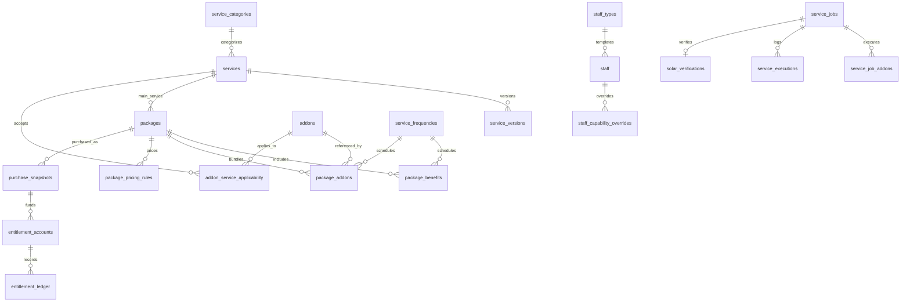

# CWP SEE-01 Database Schema (`migrations/025_create_see_engine_schema.sql`)

## ER Overview

## Core Tables & Constraints
- `public.cities`, `public.zones`, `public.vehicle_segments`: Configurable geo/timezone (`Asia/Kolkata` default) and vehicle segment (`5_seater`, `5_plus_seater`) masters.
- `public.services` & `public.service_versions`: `service_code` UNIQUE, `status` CHECK (`draft`, `active`, `retired`), `service_model` CHECK (`recurring`, `one_time`, `visit_credit`, `site_quantity`, `flexible_custom`).
- `public.service_frequencies` & `public.holiday_blackouts`: Normalized recurrence configuration (`frequency_type`, `interval_value`, `interval_unit`, `recurrence_config`, `timezone`, `missed_visit_policy`, `carry_forward_policy`).
- `public.packages`, `public.package_benefits`, `public.package_addons`, `public.package_pricing_rules`: `package_code` UNIQUE, `chk_pkg_effective_dates`, `uq_package_addon`.
- `public.addons`, `public.addon_service_applicability`: `addon_code` UNIQUE, `execution_mode` CHECK.
- `public.marketing_tags`, `public.entity_marketing_tags`, `public.media_assets`: `uq_entity_marketing_tag`, `media_slot` CHECK (`square_1_1`, `rectangle_4_3`, `gallery`, `before_proof`, `after_proof`).
- `public.staff_types`, `public.staff_type_service_capabilities`, `public.staff_type_addon_capabilities`, `public.staff_capability_overrides`: Template and override tables; `staff` extended with `staff_type_id`, `allowed_cities`, `allowed_zones`, `equipment_available`, `max_daily_jobs`.
- `public.purchase_snapshots`: `sale_reference` UNIQUE, protected by `trg_immutable_purchase_snapshot`.
- `public.entitlement_accounts` & `public.entitlement_ledger`: `chk_entitlement_ledger_balance` (`remaining_qty = purchased_qty + adjusted_qty - reserved_qty - consumed_qty - expired_qty - refunded_qty`), `idempotency_key` UNIQUE, protected by `trg_immutable_entitlement_ledger` (append-only).
- `public.service_jobs` (extended), `public.service_job_addons`, `public.service_executions`, `public.solar_verifications`, `public.legacy_service_mapping`: Hardcoded `chk_job_target` dropped in favor of FK to `service_categories(id)`.
